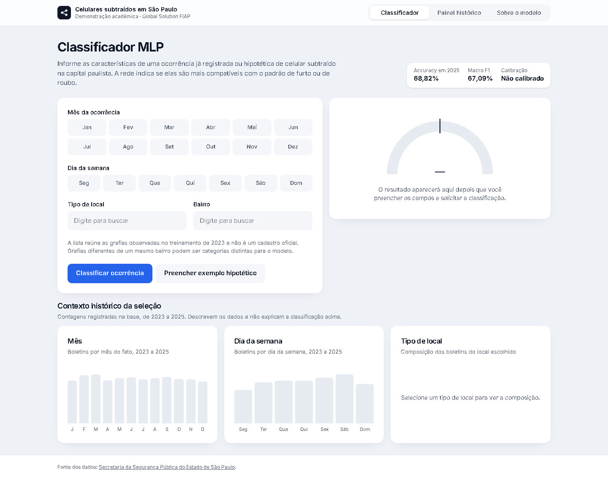
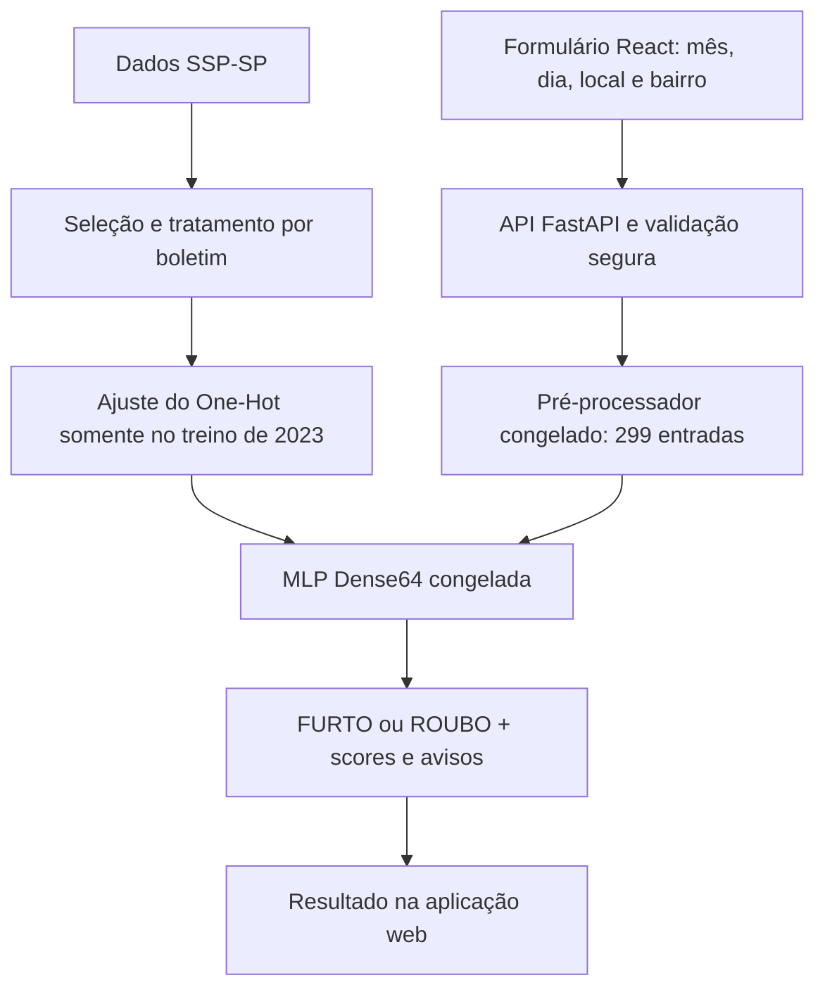

# Classificação de Roubos e Furtos de Celulares em São Paulo

Projeto de Deep Learning desenvolvido para a Global Solution FIAP 2026.2, utilizando redes neurais MLP e dados públicos da SSP-SP.


Uma aplicação acadêmica que recebe quatro características de uma ocorrência de celular subtraído e apresenta uma classificação estimada: **FURTO ou ROUBO**. O projeto reúne engenharia de dados, comparação de três MLPs, avaliação temporal, auditoria e uma plataforma web integrada ao modelo congelado.

**[Experimente a aplicação →](https://spcrimeclassification.vercel.app/)** · **[Leia o notebook completo →](notebooks/GS_Classificacao_MLP_Completo.ipynb)**

[Demonstração](#demonstracao) · [Resultados](#resultados) · [Tecnologias](#tecnologias) · [Instalação](#instalacao) · [Notebook](#notebook)

<a id="demonstracao"></a>
## Experimente a aplicação

Na [demonstração pública](https://spcrimeclassification.vercel.app/), selecione mês, dia da semana, tipo de local e bairro. A plataforma apresenta a classe estimada, scores não calibrados e avisos. O painel histórico permite explorar agregados de 2023–2025; a página sobre o modelo explica arquitetura e resultados.

**Verificação em 11/11/2026:** página, `/api/health`, `/api/options` e `/api/classify` responderam HTTP 200. O exemplo sintético de maio, quarta-feira, via pública e Bela Vista retornou FURTO pela Dense64 v1.0.0. Essa é uma verificação pontual, não uma garantia de disponibilidade contínua.

[](https://spcrimeclassification.vercel.app/)

*Captura real da página pública em 11/11/2026, sem dados individuais de boletins.*

## O problema

A MLP aprende associações entre o contexto informado e os rótulos registrados pela SSP-SP, dentro do recorte selecionado. Seu objetivo é demonstrar e discutir classificação supervisionada.

**A rede não prevê crimes futuros**, não identifica pessoas, não determina a natureza jurídica de um fato e não produz rankings de segurança de bairros.

## Os dados utilizados

- **Fonte:** [SSP-SP — consultas estatísticas, celulares subtraídos](https://www.ssp.sp.gov.br/estatistica/consultas).
- **Recorte:** município de São Paulo, pela circunscrição do fato, com código IBGE corroborativo.
- **Período:** fatos de 2023 a 2025; divisão pelo ano do fato, não pelo arquivo.
- **Base elegível:** **505.187 boletins**, com uma observação consolidada por BO.
- **Classes:** 298.083 FURTOS (59,00%) e 207.104 ROUBOS (41,00%).

As 1.286.316 linhas originais representam vínculos de 995.565 boletins distintos. O tratamento consolida vínculos e segrega casos fora do recorte, conflitos, classes mistas e outras naturezas associadas. Os rótulos usam as rubricas exatas de furto (art. 155) e roubo (art. 157), sem busca por substring.

| Partição temporal | Boletins | Papel |
| --- | ---: | --- |
| 2023 | 190.124 | Treinamento e ajuste do pré-processador |
| 2024 | 158.895 | Desenvolvimento, validação e seleção |
| 2025 | 156.168 | Avaliação final histórica, já consumida |

XLSX, Parquet e registros individuais ficam fora do GitHub. O notebook usa agregados e figuras salvos, sem exigir as planilhas. [Seleção e qualidade dos dados](reports/relatorio_etapa1.md).

## Como funciona



A versão final usa **299 entradas → 64 neurônios ReLU → 1 saída sigmoid**, com **19.265 parâmetros** e limiar **0,5**. Bairros com menos de 50 exemplos no treino compartilham uma representação de raros. A validação segura bloqueia entradas incompatíveis antes da rede.

<a id="resultados"></a>
## Resultados

**Dense64 final — avaliação histórica de 2025:**

| Accuracy | Macro F1 | Recall de ROUBO | Precision de ROUBO | Balanced accuracy |
| ---: | ---: | ---: | ---: | ---: |
| **68,82%** | **67,09%** | **63,42%** | 56,15% | 67,65% |

As três arquiteturas foram efetivamente treinadas na Etapa 4. A comparação abaixo usa **2024, semente 42, mesmas entradas e três épocas fixas**, após treino em 2023:

| Arquitetura | Parâmetros | Accuracy | Macro F1 | Recall de ROUBO |
| --- | ---: | ---: | ---: | ---: |
| Dense32 | 9.633 | 68,60% | 67,75% | 62,18% |
| **Dense64** | **19.265** | **68,51%** | **67,69%** | **62,53%** |
| Dense64 → Dense32 | 21.313 | 68,10% | 67,52% | 64,98% |

A escolha histórica da Dense64 considerou estabilidade nas três inicializações examinadas e simplicidade frente à profunda. **Dense32 é competitiva**, com metade dos parâmetros, mas só teve uma semente de reajuste completo. A profunda ganhou recall ao custo de mais falsos positivos. Não houve ganho consistente de maior capacidade.

**Ressalva da auditoria:** a MLP supera a referência majoritária, mas não demonstrou vantagem consistente sobre uma tabela de frequências de 2023 por local/bairro: Accuracy 69,28% e Macro F1 67,27% em 2025. A tabela foi construída depois do teste; é um diagnóstico retrospectivo, não uma avaliação independente ou substituição do modelo selecionado. [Comparação e errata](reports/relatorio_etapa5.md).

## Metodologia em poucas etapas

1. Auditar fonte, granularidade, datas, geografia e rótulos; consolidar uma observação por BO.
2. Selecionar quatro atributos; ajustar categorias, ausências e raridade somente no treino.
3. Desenvolver as arquiteturas em divisão temporal interna de 2023 e fixar o orçamento antes de comparar em 2024.
4. Selecionar e congelar pesos, pré-processador, limiar e manifesto; avaliar 2025 historicamente.
5. Auditar resultados e corrigir interpretação/validação, preservando a rede; integrar API e interface.

O baseline da Etapa 2 usou Early Stopping em 2024 e não é o checkpoint final. A Etapa 4 usou três épocas fixas escolhidas internamente em 2023. **2025 já foi explorado e avaliado; não é teste independente disponível para uma v2.**

<a id="tecnologias"></a>
## Tecnologias

| Responsabilidade | Tecnologias verificadas |
| --- | --- |
| Machine Learning | Python 3.12, TensorFlow 2.20.0, Keras 3.11.3, scikit-learn 1.7.2, NumPy, SciPy e joblib |
| Engenharia e análise | DuckDB, PyArrow e Matplotlib |
| Backend | FastAPI 0.121, Pydantic, Starlette e Uvicorn 0.38 |
| Frontend | React 19.3.1, TypeScript 7.0.2, Vite 8.3.7, Tailwind CSS 4.3.5, React Router e Recharts |
| Testes | pytest, HTTPX, Vitest, Testing Library e Playwright |
| Infraestrutura | Git/GitHub, Vercel para a demonstração e Dockerfile disponível para contêiner |

Versões ML: `requirements-*.txt` e manifesto. Versões frontend: [package-lock.json](web/frontend/package-lock.json). Os badges representam essas versões, não estados de testes ou disponibilidade.

## Estrutura do repositório

```text
notebooks/
  GS_Classificacao_MLP_Completo.ipynb   # Entrega acadêmica única
src/
  data/                               # Ingestão e preparação
  ml/                                 # Baseline histórico
  diagnostics/                        # Diagnóstico da Etapa 3
  experiments4/                       # Três arquiteturas e experimentos
  final5/                             # Pipeline congelado e contrato seguro
  maintenance56/                      # Verificações de preservação
reports/                              # Resultados, figuras e auditorias
docs/                                 # Protocolos, contratos e guias
models/final/                         # Manifesto público; binários locais
web/
  backend/                            # API e agregados públicos
  frontend/                           # Interface React
tests/                                # Testes de dados e ML
```

<a id="instalacao"></a>
## Executar localmente

Requisitos: **Python 3.12**, **Node.js 22** e os **artefatos finais aprovados**. Comandos PowerShell, na raiz do projeto:

```powershell
git clone https://github.com/matheeusvx/SP-Crime-Classification-MLP.git
cd SP-Crime-Classification-MLP
python -m venv .venv
.venv/Scripts/python.exe -m pip install -r requirements-web.txt
npm ci --prefix web/frontend
```

**Antes de iniciar a API:** obtenha `modelo.keras` e `preprocessador.joblib` com o mantenedor, por canal separado, e coloque-os em `models/final/`. Eles não estão publicados no GitHub e **um clone sozinho não habilita a inferência**. Não há link público confirmado para baixar os binários. Nunca carregue joblib de origem desconhecida.

Mantenha junto deles os arquivos públicos `config_final.json`, `contrato.json`, `manifesto.json` e `manifesto.sha256`. A carga verifica hashes, fontes e dimensões. Não substitua por outro experimento. Sem artefatos válidos, health/classificação retornam 503.

No primeiro terminal:

```powershell
.venv/Scripts/python.exe -m uvicorn app.main:app --app-dir web/backend --host 127.0.0.1 --port 8000
```

No segundo terminal:

```powershell
npm run dev --prefix web/frontend
```

Abra [localhost:5173](http://localhost:5173). O Vite encaminha `/api` à porta 8000; não é necessário `VITE_API_BASE_URL` nesse fluxo. Configuração: [backend](web/backend/.env.example) e [frontend](web/frontend/.env.example). Em cópia local antiga, use ambiente novo e evite misturar pastas ignoradas `.runtime*` com o virtualenv.

<details>
<summary>Conferir os endpoints e executar testes da aplicação</summary>

```powershell
Invoke-RestMethod http://127.0.0.1:8000/api/health
Invoke-RestMethod http://127.0.0.1:8000/api/options
$entrada = @{mes=5; dia_semana=2; tipo_local='VIA PÚBLICA'; bairro='BELA VISTA'} | ConvertTo-Json
Invoke-RestMethod http://127.0.0.1:8000/api/classify -Method Post -ContentType 'application/json; charset=utf-8' -Body ([System.Text.Encoding]::UTF8.GetBytes($entrada))
```

Espere `status=ok`, `modelo_carregado=true`, opções de formulário e uma classificação real. Para esse exemplo, a Dense64 retorna FURTO, com score de roubo ≈0,255359.

```powershell
.venv/Scripts/python.exe -m pip install -r requirements-web-dev.txt
.venv/Scripts/python.exe -m pytest web/backend/tests/test_api.py -q
npm test --prefix web/frontend
npm run build --prefix web/frontend
```

Os testes usam os binários finais confiáveis e agregados versionados; não treinam nem avaliam 2025 novamente. [Guia da aplicação](web/README.md).

</details>

<details>
<summary>Reprodução histórica e preservação</summary>

O notebook contém código real das três MLPs e chamadas aos scripts originais, **desativadas por padrão**. Reproduzir exige dados locais auditados e `requirements-ml.txt`; use uma cópia histórica separada, conforme o notebook, pois os scripts antigos conferem os bytes originais de documentos e notebooks.

Não execute runners históricos completos para validar documentação: podem gravar relatórios ou exigir dados privados. Não apague caches/registros de 2025 nem use o ano para escolher configurações. [Rastreabilidade da consolidação](docs/consolidacao_academica.md) e [versionamento histórico](docs/versionamento.md).

`src/ml/inference.py` é legado do baseline. Novas integrações usam `final5.validation.SafeClassifier`, contrato 1.1.0, sem duplicar normalização nem mover classes referenciadas pelo joblib. [Contrato seguro](docs/contrato_inferencia_seguro.md).

</details>

<a id="notebook"></a>
## Notebook acadêmico

**[GS_Classificacao_MLP_Completo.ipynb](notebooks/GS_Classificacao_MLP_Completo.ipynb)**

Um único documento reúne introdução, dados, exploração, tratamento, baseline, implementação e treinamento das três arquiteturas, comparação de métricas, curvas, matriz final, auditoria e integração web. Tabelas e figuras estão salvas para leitura no GitHub, sem baixar planilhas ou executar treinamentos.

As células padrão leem agregados e fontes; a reprodução opcional permanece bloqueada. Os cinco notebooks anteriores são recuperáveis pelo Git. Aprofundamento: [Etapa 1](reports/relatorio_etapa1.md), [Etapa 2](reports/relatorio_etapa2.md), [Etapa 3](reports/relatorio_etapa3.md), [Etapa 4](reports/relatorio_etapa4.md), [Etapa 5 e errata](reports/relatorio_etapa5.md).

## Limitações e responsabilidade

- **Scores não calibrados:** sigmoid não é chance de crime futuro. Houve superestimação média de roubo ≈8,10 pp em 2025; a errata separa calibração de limiar.
- **Referências estatísticas:** não há superioridade consistente demonstrada sobre a tabela retrospectiva de frequências.
- **Preenchimento administrativo:** local ausente/OUTROS se associa ao canal de registro e mudou entre anos; risco de proxy, sem vazamento comprovado.
- **Bairros:** grafias podem ser categorias distintas; raros compartilham uma coluna e podem concentrar falsos positivos. O vocabulário não é cadastro territorial oficial.
- **Generalização restrita:** exclusão conservadora e assimétrica de naturezas; não cobre todos os crimes, cidades ou períodos futuros. Intervalos IID não capturam toda a incerteza temporal/de treino.
- **Uso acadêmico:** não é sistema oficial nem ferramenta validada para decisões policiais, jurídicas ou operacionais.

[Auditoria independente](reports/auditoria_claude.md) · [Correções](reports/relatorio_correcoes_pos_auditoria.md) · [Limitações detalhadas](docs/limitacoes_modelo_final.md)

## Autoria e referências

Repositório mantido por **[matheeusvx](https://github.com/matheeusvx)** no contexto da **Global Solution FIAP 2026.2**. Nome acadêmico completo, RM e turma não foram identificados nos documentos acadêmicos consultados e não foram presumidos.

**IA generativa:** Codex apoiou desenvolvimento, testes, integração e documentação. Claude realizou a auditoria técnica registrada, em revisão separada. Essas ferramentas não substituem conferência das evidências nem responsabilidade do autor; a auditoria por IA não é certificação institucional.

Fonte: [SSP-SP](https://www.ssp.sp.gov.br/estatistica/consultas). Contexto acadêmico: [FIAP](https://www.fiap.com.br/). Metodologia: [Keras](https://keras.io/api/) e [scikit-learn](https://scikit-learn.org/stable/). A menção às instituições não implica endosso ao modelo ou à aplicação.
