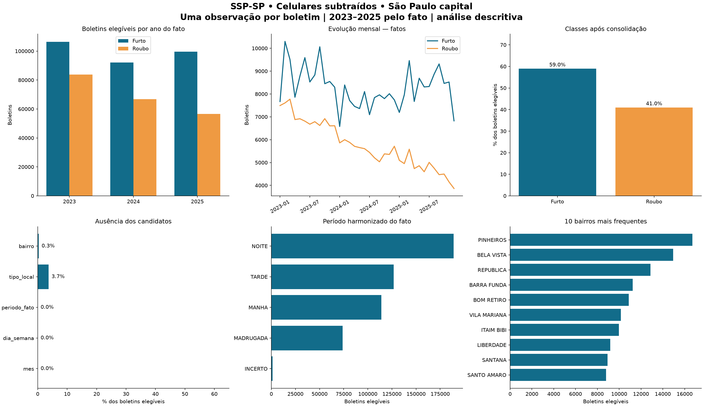

# Etapa 1 — Segurança Pública Inteligente em São Paulo

Execução local em 09/11/2026. Somente preparação, sem treinamento ou aplicação web.

## A. Arquivos analisados

| arquivo | ano | MB_decimais | abas | colunas | linhas | leitura_s | RSS_amostrado_MB |
| --- | --- | --- | --- | --- | --- | --- | --- |
| CelularesSubtraidos_2023.xlsx | 2023 | 137.6 | 3 | 55 | 490154 | 95.14 | 193.6 |
| CelularesSubtraidos_2024.xlsx | 2024 | 118.61 | 3 | 55 | 412527 | 80.94 | 184.4 |
| CelularesSubtraidos_2025.xlsx | 2025 | 108.12 | 3 | 55 | 383635 | 76.0 | 183.4 |

Todos são XLSX OOXML reais, com metodologia, dicionário e uma aba de dados. São 55 colunas por arquivo; esquema detalhado e diferenças em `tables/comparacao_esquemas.csv`. Originais preservados e verificados por SHA256. O universo é de boletins com celulares subtraídos, não de todos os crimes da capital. Proveniência e referências em `../docs/decisoes.md`.

## B. Recorte e tratamento

| ano_arquivo | originais | linhas_capital | municipio_indeterminado | outros_municipios | conflitos_ibge | chave_incompleta | hora_invalida |
| --- | --- | --- | --- | --- | --- | --- | --- |
| 2023 | 490154 | 267899 | 0 | 222255 | 0 | 0 | 0 |
| 2024 | 412527 | 223839 | 0 | 188688 | 0 | 0 | 0 |
| 2025 | 383635 | 216287 | 0 | 167348 | 0 | 0 | 0 |

Filtro primário: `NOME_MUNICIPIO_CIRC`, município da circunscrição do fato; `CD_IBGE=3550308` corrobora quando preenchido. Não usar `NOME_MUNICIPIO` do registro. Não houve município ausente nem conflito IBGE/capital nas linhas; existem BOs com linhas de diferentes municípios. `CIDADE` tem descrição divergente entre dicionários e não é usada para filtrar. Não há geocodificação independente de cada endereço; a validação é semântica e por consistência dos campos da fonte.

As 1,286,316 linhas representam 995,565 chaves distintas de boletim. O resultado é **505,187 boletins elegíveis**, sustentados por 566,582 linhas originais. Há 490,378 boletins segregados (49.26% das chaves). 719,734 linhas não pertencem a BOs elegíveis (55.95% das linhas); outras 61,395 são vínculos consolidados dos BOs mantidos, não exclusões de crimes. Não confundir esses denominadores.

| decisao | boletins | linhas_origem | pct_boletins |
| --- | --- | --- | --- |
| elegivel | 505187 | 566582 | 50.7437 |
| fora_capital_ou_indeterminado | 411798 | 570352 | 41.3632 |
| sem_classe_binaria | 61452 | 65158 | 6.1726 |
| outras_naturezas_associadas | 12708 | 64564 | 1.2765 |
| fato_fora_2023_2025 | 2879 | 3311 | 0.2892 |
| geografia_conflitante | 1392 | 15500 | 0.1398 |
| roubo_e_furto_no_bo | 149 | 849 | 0.015 |

Os motivos são mutuamente exclusivos por prioridade: geografia, data inválida/conflitante, período, duas classes, ausência de classe e outras naturezas. Os critérios secundários e sobreposições são diagnosticados nas demais tabelas. BOs com múltiplas naturezas são segregados conservadoramente; isso reduz cobertura e pode selecionar casos mais simples. Essa decisão deve ser avaliada antes de ampliar o escopo.

## C. Classes

Convenção: **0=FURTO; 1=ROUBO**. Só igualdade normalizada com `Furto (art. 155)` ou `Roubo (art. 157)`. Nenhuma regra por substring. “Furto de coisa comum (art. 156)” não é equiparado automaticamente. Todas as demais rubricas e suas frequências/decisões estão em `tables/mapeamento_classes.csv`. Qualificadoras são mantidas dentro da rubrica reconhecida; não são atributos. Todos os registros observados têm `FLAG_STATUS=CONSUMADO`; não há tentativas para avaliar nesta entrega.

| alvo | boletins | percentual |
| --- | --- | --- |
| 0 | 298083 | 59.0045 |
| 1 | 207104 | 40.9955 |

| ano_fato | alvo | boletins | pct_ano |
| --- | --- | --- | --- |
| 2023 | 0 | 106421 | 55.9745 |
| 2023 | 1 | 83703 | 44.0255 |
| 2024 | 0 | 92055 | 57.9345 |
| 2024 | 1 | 66840 | 42.0655 |
| 2025 | 0 | 99607 | 63.782 |
| 2025 | 1 | 56561 | 36.218 |

O ano acima é o do fato, não o do arquivo nem do registro. Há desbalanceamento moderado e mudança da proporção de classes entre anos; não houve balanceamento artificial. Comparações temporais descrevem esta extração e seus filtros, não as estatísticas oficiais de criminalidade.

## D. Qualidade

| ano_arquivo | menor | maior | invalidas | ausentes | fora_ano_arquivo |
| --- | --- | --- | --- | --- | --- |
| 2023 | 2003-11-01 | 2025-02-04 | 0 | 0 | 6052 |
| 2024 | 2005-02-09 | 2025-01-16 | 0 | 0 | 4863 |
| 2025 | 2005-11-25 | 2025-12-31 | 0 | 0 | 5068 |

As datas mínimas chegam a 2003, apesar dos nomes dos arquivos 2023–2025. Datas fora do ano do arquivo são sinalizadas; fatos de outro ano ainda em 2023–2025 podem permanecer. Fatos anteriores a 2023 são segregados. Datas de registro anteriores ao fato são inconsistências da fonte, contadas abaixo. A elegibilidade usa a data do fato válida; esses atrasos negativos não são corrigidos nem usados como atributos. Não há evidência externa para reconstruir a data correta.

| ano_arquivo | registro_anterior_fato | atraso_medio_dias | atraso_mediano_dias |
| --- | --- | --- | --- |
| 2023 | 3080 | 4.847276570220788 | 1.0 |
| 2024 | 1415 | 6.037420580955914 | 1.0 |
| 2025 | 448 | 6.628534935550719 | 1.0 |

| boletins | multiplas_linhas | linhas_acima_de_um_por_bo | em_multiplos_arquivos | multiplas_versoes | multiplas_naturezas | classes_mistas | datas_conflitantes |
| --- | --- | --- | --- | --- | --- | --- | --- |
| 995565 | 120140 | 290751 | 4 | 12 | 33975 | 267 | 0 |

| ano_arquivo | linhas | linhas_distintas | repeticoes_exatas |
| --- | --- | --- | --- |
| 2023 | 490154 | 490154 | 0 |
| 2024 | 412527 | 412527 | 0 |
| 2025 | 383635 | 383635 | 0 |

Não foram encontradas linhas integralmente idênticas por arquivo, mas há muitos vínculos por boletim. A inspeção conjunta encontra quatro chaves em múltiplos arquivos. Repetições são consolidadas por chave, não removidas sem examinar natureza, data e geografia. Não é possível detectar com segurança dois BOs diferentes que descrevam o mesmo fato; falta um identificador universal do evento.

`NULL`, vazio, `N/A` e `NAN` são marcadores explícitos de ausência. Códigos e identificadores permanecem textuais no intermediário. Valores categóricos recebem apenas trim e maiúsculas; não há fusão automática de bairros por semelhança. Em boletins elegíveis, 184 conflitos de tipo de local e 470 de bairro viram ausente; a regra usa consenso dos valores não ausentes e não escolhe a primeira linha. `FLAG_STATUS` é constante, portanto não acrescenta informação.

`tables/perfil_colunas.csv` registra por campo/ano quantos marcadores de ausência são convertidos em nulo e quantas linhas seriam alteradas por trim ou maiúsculas. Maiúsculas são aplicadas somente nas comparações de chaves/rubricas/município e na consolidação de categorias, não indiscriminadamente em todo o intermediário. `ambiente.json` documenta Python, versões das dependências e recursos disponíveis.

## E. Atributos candidatos

| atributo | linhas | ausentes | ausentes_pct | cardinalidade |
| --- | --- | --- | --- | --- |
| mes | 505187 | 0 | 0.0 | 12 |
| dia_semana | 505187 | 0 | 0.0 | 7 |
| periodo_fato | 505187 | 0 | 0.0 | 5 |
| tipo_local | 505187 | 18752 | 3.7119 | 28 |
| bairro | 505187 | 1691 | 0.3347 | 2328 |

Recomendações completas, significado, tipos, transformações e riscos em `tables/recomendacao_atributos.csv`; os 165 perfis de coluna/ano e seus significados estão em `tables/dicionario_dados.csv`.

Hora e período brutos têm 48,47% e 51,53% de ausência, respectivamente, com ausência complementar e fortemente associada à classe. Por isso **não são entradas separadas**, nem se fornece um indicador de qual campo veio preenchido. `periodo_fato` harmoniza hora conhecida e período declarado: 00–05=MADRUGADA, 06–11=MANHA, 12–17=TARDE, 18–23=NOITE; “Em hora incerta”=INCERTO. As faixas são uma convenção operacional deste projeto, não uma definição confirmada da SSP; não se inventa uma hora exata para períodos amplos. A incerteza temporal ainda pode refletir o processo de registro e deve ser investigada. `tables/qualidade_temporal_atributos.csv` preserva a evidência por ano/classe. Bairro tem cardinalidade elevada e grafias livres, não deve ser confundido com distrito administrativo. Sua inclusão definitiva e a sensibilidade às faixas de período ficam para avaliação na Etapa 2, sem usar desempenho do teste final.

Campos de natureza, lei, conduta, desdobramento, circunstância e sinalizadores jurídicos ficam fora das entradas. Identificadores, coordenadas precisas, logradouro, número, CEP, campos pós-registro, marca de objeto, corporação apresentante e autoria também não são selecionados. Ano do fato, chave e data completa ficam apenas nos metadados. A base de modelagem recebe cinco atributos contextuais e a coluna-alvo separável; nenhum codificador foi ajustado.

## Análise exploratória

As tabelas de classes mensais cobrem ano/mês do fato; distribuições de bairro e período preservam ausentes. Gráficos são descritivos e não evidenciam causalidade nem risco futuro. Não há medição de utilidade preditiva nesta etapa.

## F. Arquivos produzidos

| arquivo | MB_decimais |
| --- | --- |
| amostra_experimental_20000.parquet | 0.823 |
| base_modelagem.parquet | 1.469 |
| metadados_modelagem.parquet | 18.862 |
| ocorrencias_elegiveis.parquet | 20.227 |
| quarentena_boletins.parquet | 17.623 |

- `data/interim/2023.parquet`, `2024.parquet`, `2025.parquet`: cópias intermediárias locais, com lexemas originais e rastreabilidade.
- `data/processed/ocorrencias_elegiveis.parquet`: uma linha por BO, atributos, classe e metadados analíticos, sem endereço preciso.
- `data/processed/base_modelagem.parquet`: apenas cinco candidatos e alvo; `esquema_modelagem.json` define a lista explícita de entradas.
- `data/processed/metadados_modelagem.parquet`: chave, data, ano e município, alinhados por índice de linha à base de modelagem.
- `data/processed/quarentena_boletins.parquet`: chave e motivo de segregação; os originais permitem investigar os vínculos, sem exemplos pessoais no relatório.
- `data/processed/amostra_experimental_20000.parquet`: amostra de BOs elegíveis com metadados; selecionar as mesmas cinco entradas para modelar.
- `src/data/`: scripts reutilizáveis; `notebooks/01_auditoria_exploracao.ipynb`: análise executada com agregados.
- `reports/tables/`: auditoria, mapeamento, distribuições, perdas e amostragem; `tests/test_integridade.py`: testes independentes.

Verificação automatizada: **8 testes executados; 0 falhas; 0 erros**. Inclui conservação por SHA256, recorte/período/rótulos contra todas as linhas da fonte, unicidade, esquema permitido, reconciliação de unidades, alinhamento e cotas amostrais. Os testes falham com saída diferente de zero, sem ocultar problemas.

## G. Cenários e recomendações para a Etapa 2

**A — 20 mil BOs:** cotas proporcionais por ano, mês e classe, pelo método de maior resto e ordenação SHA256 com semente textual fixa. Reproduzível e sem equilíbrio forçado; pode perder categorias raras. A amostra é subconjunto do cenário B e não constitui avaliação independente.

**B — 505,187 BOs:** maior cobertura de períodos e categorias, maior custo de treino e memória. Não há garantia de maior acurácia. Não contar múltiplos vínculos como exemplos adicionais.

Estimativa ilustrativa de matriz One-Hot densa float32, incluindo uma categoria ausente por variável e todos os níveis observados: 2,385 colunas, cerca de **182.0 MiB** para A e **4,596.2 MiB** para B, apenas entradas, sem pesos, ativações ou otimizador. É uma estimativa de teto descritivo, não um codificador ajustado. Sparse e lotes reduzem o armazenamento; uma futura MLP pode exigir densificação por lote. Agrupar bairros raros exclusivamente no treino pode reduzir a dimensão.

Proposta a revisar: treino com fatos de 2023, validação 2024, teste final 2025. A chave de BO deve permanecer indivisa. Não foi fixada nem materializada uma divisão nesta etapa. Ajustar One-Hot, imputação, categorias raras e escalas apenas no treino, com tratamento de valores desconhecidos. Considerar codificação cíclica para tempo e classe majoritária como referência na avaliação posterior. Não usar teste para escolher atributos, arquitetura ou hiperparâmetros.

## H. Pendências para avaliação do usuário

1. Aceitar a exclusão conservadora dos BOs com outras naturezas associadas ou solicitar estudo de ampliação, sem atribuir um único crime a um objeto por suposição.
2. Revisar a convenção do período harmonizado e a inclusão de bairros de alta cardinalidade, com tratamento aprendido somente no treino.
3. Confirmar a proposta temporal e o cenário experimental/ampliado, considerando o domínio restrito a celulares e a mudança de sistemas da SSP.
4. A semântica geográfica exata de `CD_IBGE` não está explicitada no dicionário; foi usado como corroborador. `CIDADE` tem documentação contraditória e foi excluída do critério. Não há validação externa de endereços nem reconstrução de datas inconsistentes.

As pendências delimitam escolhas da próxima etapa e limitações da fonte. Não impedem reproduzir a base conservadora entregue. **A execução para nesta Etapa 1.**
