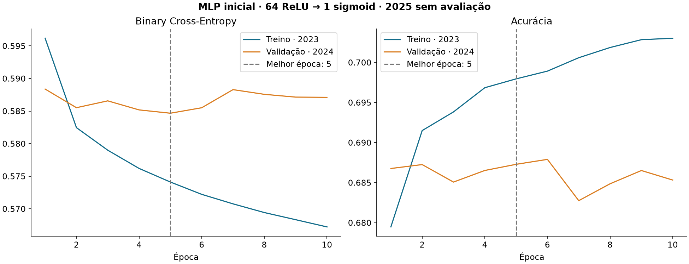
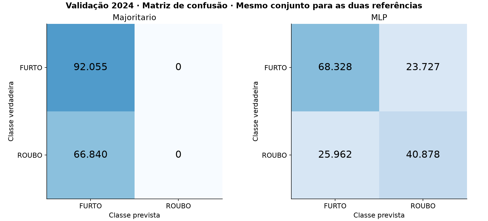

# Etapa 2 — Primeira MLP para celulares subtraídos

Execução em 09/11/2026. Uma única arquitetura, treinada efetivamente. Não há aplicação web nem comparação sistemática de arquiteturas. O domínio é o extrato SSP-SP de **boletins envolvendo celulares subtraídos em São Paulo capital**, tratado na Etapa 1. Não representa todos os crimes da cidade nem previsão de risco criminal futuro.

## A. Dados utilizados e integridade

Treinamento: **190,124 boletins de 2023**. Validação: **158,895 de 2024**. Teste final: **156,168 de 2025, sem transformação preditiva, previsões ou métricas**. Toda a base permitida foi utilizada; a amostra de 20 mil não foi necessária. O ano foi derivado da data do fato nos metadados.

Antes de treinar, foram conferidos esquema, tipos, rótulos, índices contíguos, chaves únicas e ausência de sobreposição temporal. O alinhamento foi verificado célula a célula contra `ocorrencias_elegiveis.parquet`, por chave e índice, incluindo rótulo e data. Não se confiou apenas na posição das linhas. Uma perturbação em memória nos metadados é rejeitada pelos testes.

| ano | tuplas_X_distintas | repeticoes_X_entre_BOs | tuplas_X_com_ambas_classes |
| --- | --- | --- | --- |
| 2023 | 45017 | 145107 | 12274 |
| 2024 | 42372 | 116523 | 11452 |

Tuplas de atributos iguais em BOs diferentes são esperadas e **não foram removidas**. Existem contextos idênticos associados às duas classes, evidenciando que as quatro entradas não determinam a resposta. A base consolidada permanece com uma observação por boletim e com as exclusões conservadoras da Etapa 1.

Hashes dos artefatos anteriores constam em `etapa2/etapa1_preservacao.json` e são reconferidos nos testes. Os arquivos da Etapa 1, seus relatórios, notebook e oito testes foram preservados. As únicas leituras de 2025 nesta etapa são verificações estruturais de alinhamento, contagem e chaves, sem escolher vocabularios, frequências, hiperparâmetros ou atributos a partir dele.

## B. Pré-processamento e inspeção semântica

Entradas exatas: **`mes`, `dia_semana`, `tipo_local`, `bairro`**. O alvo é separado: **0=FURTO, 1=ROUBO**. `periodo_fato`, hora, indicadores de preenchimento temporal, ano, chave, data completa, natureza, rubricas, lei, endereço e coordenadas não entram no pré-processador nem no modelo.

Mês e dia da semana recebem One-Hot, sem impor magnitude ou distância ordinal. Todas as quatro variáveis são categóricas. Os intervalos válidos são mês 1–12 e dia 0–6, segunda-feira=0. Valores numéricos inválidos e colunas extras são rejeitados. Ausências recebem categoria explícita, sem remover linhas. Não há escalonamento, imputação por moda ou balanceamento artificial.

Tipos de local e bairros foram inspecionados **somente no treino**. Foram examinadas frequências, categorias raras e possíveis equivalências; a varredura de termos de natureza criminal não encontrou rubricas, roubo ou furto nas entradas de treinamento. A inspeção semântica dos tipos de local encontrou descrições de contexto (como via pública e terminal/estação), não a classificação. Isso reduz vazamento conhecido, mas não demonstra ausência universal de proxies administrativos ou vieses de registro.

Normalização: Unicode NFC, espaços e maiúsculas. Somente 16 equivalências explícitas de acentuação, inspecionadas em 2023, são ativadas quando ambas as grafias aparecem no treino. Exemplos: REPÚBLICA/REPUBLICA, BRÁS/BRAS e CONSOLAÇÃO/CONSOLACAO. Não há expansão automática de JD/VL, fusão por similaridade ou união de zonas distintas. Valores de bairro sem nenhuma letra, como códigos numéricos isolados, viram ausentes; não são interpretados como bairros.

O limiar **50 registros por bairro em 2023** é uma decisão inicial configurável de controle de cardinalidade (0.026% do treino), escolhida antes do desempenho da rede e sem busca. Mantém 247 bairros frequentes entre 1913 nomes normalizados observados. Os demais formam um bucket estatístico de baixa frequência; **não se afirma que sejam o mesmo bairro**. A tabela de frequências permanece no pré-processador e a fonte permanece intacta. Bairros novos também usam esse bucket; tipos de local novos usam a representação de ausente, já observada no treino. As contagens diagnósticas distinguem novos de ausentes, sem criar indicadores adicionais de origem como entradas.

| conjunto | n | bairro_ausente | bairro_raro_bucket | bairro_novo | tipo_local_ausente | tipo_local_novo |
| --- | --- | --- | --- | --- | --- | --- |
| treino | 190124 | 633 | 14244 | 0 | 14031 | 0 |
| validacao | 158895 | 521 | 13028 | 355 | 4653 | 0 |

O pré-processador registra ano, quantidade, hash das chaves e hash dos registros de ajuste. Vocabulários, frequência, aliases ativados e categorias raras são aprendidos somente com 2023. A transformação de 2024 não modifica o objeto. A representação é CSR float32; apenas lotes de até 256 linhas são densificados para a MLP. Uma matriz de treino densa completa exigiria aproximadamente 216.9 MiB apenas para entradas; ela não é criada.

## C. Arquitetura

- Entrada: **299 dimensões One-Hot**.
- Uma camada oculta Dense(64), ativação ReLU.
- Saída Dense(1), ativação sigmoid: probabilidade estimada de ROUBO.
- **19,265 parâmetros treináveis**.
- Perda Binary Cross-Entropy; Adam com learning rate 0,001.
- Batch size 256; até 30 épocas; semente 42.
- Early Stopping em `val_loss`, paciência 5, `min_delta=0`, restauração dos melhores pesos.
- Limiar de decisão fixo 0,5; sem otimização de threshold ou pesos de classe.

O ambiente reportado pelo TensorFlow é `[{'name': '/physical_device:CPU:0', 'type': 'CPU'}]`. CPU lógica: 16; RAM física: 31.9 GiB. Não se presumiu GPU funcional. TensorFlow usa 4 threads intraop e 1 interop; operações determinísticas habilitadas e oneDNN desabilitado para reduzir variação numérica. Reprodutibilidade numérica entre sistemas ou versões diferentes não é garantida.

## D. Treinamento real

Foram realizadas **10 épocas**, em **28.45 segundos** de `fit`. Melhor época por menor loss de validação: **5**. Motivo de parada: `early_stopping_val_loss`. Os pesos salvos são os restaurados da melhor época, não necessariamente os da última linha do histórico. Maior RSS amostrado ao fim de épocas: 646.1 MiB; é uma amostra do processo, não uma medição contínua de pico.

O histórico inclui loss, val_loss, accuracy, val_accuracy, duração e RSS por época, em `etapa2/historico_mlp.csv` e `.json`. Configuração, recursos, versões e hashes estão no arquivo de configuração do modelo. Nenhum hiperparâmetro foi alterado em resposta ao desempenho desta execução.

## E. Resultados

As métricas abaixo usam os pesos da melhor época e threshold=0,5. Precision, recall e F1 na tabela resumida referem-se à classe positiva **ROUBO**; Macro F1 e balanced accuracy dão peso igual às duas classes.

| modelo | ano | n | accuracy | precision | recall | f1 | macro_f1 | balanced_accuracy |
| --- | --- | --- | --- | --- | --- | --- | --- | --- |
| MLP | 2023 | 190124 | 0.7015 | 0.6778 | 0.6134 | 0.6440 | 0.6935 | 0.6921 |
| MLP | 2024 | 158895 | 0.6873 | 0.6327 | 0.6116 | 0.6220 | 0.6777 | 0.6769 |
| Majoritario | 2024 | 158895 | 0.5793 | 0.0000 | 0.0000 | 0.0000 | 0.3668 | 0.5000 |

Métricas por classe:

| modelo | ano | classe | precision | recall | f1 | suporte | previsoes |
| --- | --- | --- | --- | --- | --- | --- | --- |
| MLP | 2024 | FURTO | 0.7247 | 0.7423 | 0.7333 | 92055 | 94290 |
| MLP | 2024 | ROUBO | 0.6327 | 0.6116 | 0.6220 | 66840 | 64605 |
| Majoritario | 2024 | FURTO | 0.5793 | 1.0000 | 0.7337 | 92055 | 158895 |
| Majoritario | 2024 | ROUBO | 0.0000 | 0.0000 | 0.0000 | 66840 | 0 |

As linhas da matriz são classes verdadeiras e as colunas são previstas, na ordem FURTO, ROUBO. Distribuição verdadeira versus prevista aparece nas colunas `suporte` e `previsoes`. Não há previsão ou métrica de 2025.

## F. Comparação com a referência

A classe majoritária foi determinada **somente em 2023**: FURTO. A referência sempre prevê FURTO, sem rede neural. Na mesma validação de 2024, sua acurácia é 0.5793, Macro F1 0.3668 e balanced accuracy 0.5000; recall de ROUBO é zero. Métricas sem previsões positivas usam `zero_division=0` e são explicitadas como zero, não omitidas.

A MLP obteve diferença de **+10.79 pontos percentuais de acurácia** e **+0.3108 de Macro F1** em relação à referência. O confronto inclui as duas classes e a matriz, em vez de interpretar acurácia isoladamente. A referência não foi ajustada à distribuição de 2024.

## G. Análise crítica e erros

Com os melhores pesos, a diferença de acurácia treino−validação é +1.42 pontos percentuais; a diferença de BCE validação−treino é +0.0144. No histórico, a melhor val_loss é 0.58467, e a última é 0.58711. A redução continuada do erro de treino sem melhoria equivalente no erro de validação deve ser tratada como possível sobreajuste; a diferença temporal também pode contribuir. Estas duas causas não são separáveis apenas com uma divisão temporal.

Em 2024, a MLP confunde **23,727 furtos com roubos** e **25,962 roubos com furtos**. O recall por classe acima mostra a assimetria. A prevalência observada muda de 0.4403 de roubos no treino para 0.4207 na validação, além de mudanças de bairros, locais e preenchimento. Não se atribui causalidade ao ano.

Contextos com mais erros absolutos por tipo de local, apenas em grupos com pelo menos 50 exemplos:

| atributo | categoria | boletins | erros | taxa_erro | furtos_verdadeiros | roubos_verdadeiros |
| --- | --- | --- | --- | --- | --- | --- |
| tipo_local | VIA PÚBLICA | 124809 | 44884 | 0.3596 | 62803 | 62006 |
| tipo_local | TERMINAL/ESTAÇÃO | 15821 | 2088 | 0.1320 | 13744 | 2077 |
| tipo_local | OUTROS | 7706 | 713 | 0.0925 | 6993 | 713 |
| tipo_local | (AUSENTE) | 4653 | 479 | 0.1029 | 4174 | 479 |
| tipo_local | RESIDÊNCIA | 1123 | 337 | 0.3001 | 802 | 321 |
| tipo_local | ESTACIONAMENTO/GARAGEM | 854 | 304 | 0.3560 | 479 | 375 |
| tipo_local | COMÉRCIO E SERVIÇOS | 759 | 243 | 0.3202 | 533 | 226 |
| tipo_local | RESTAURANTE E AFINS | 571 | 140 | 0.2452 | 435 | 136 |

Grupos maiores podem acumular mais erros apenas por volume; compare também `taxa_erro`. O arquivo `etapa2/erros_por_grupo_validacao.csv` contém estratos por mês, dia, local e bairro. Esses diagnósticos são posteriores ao congelamento desta rede e não foram usados para alterar seus hiperparâmetros. Grupos pequenos são omitidos da tabela de desempenho para não superinterpretar taxas instáveis.

Mesmo boa otimização não recupera informação ausente: muitos BOs têm os mesmos quatro atributos e classes diferentes. Um desempenho limitado pode refletir representação insuficiente, ambiguidade do contexto, mudança temporal ou capacidade da arquitetura; esta execução não distingue de forma definitiva underfitting e limite informacional. Ausência de métricas excepcionalmente elevadas não prova ausência de vazamento. Retirar o período reduz o risco conhecido de preenchimento temporal, mas local/bairro ainda podem refletir práticas de registro. A exclusão conservadora de naturezas mistas seleciona parte do universo de celulares e limita generalização.

## H. Artefatos, inferência e testes

- `models/mlp_baseline.keras`: arquitetura, pesos e estado de compilação no formato Keras.
- `models/arquitetura_mlp.json`: arquitetura legível separada.
- `models/preprocessador.joblib`: normalização e vocabulário/frequências ajustados em 2023.
- `models/config_modelo.json`: entradas, tipos, rótulos, hiperparâmetros, execução, versões e proveniência.
- `notebooks/02_mlp_baseline.ipynb`: notebook executado, com interpretação, resultados e exemplo real de recarga.
- `src/ml/`: dataset, pré-processamento, treinamento, avaliação e interface Python de inferência.
- `reports/tables/metricas_baseline.csv` e `metricas_baseline_por_classe.csv`; figuras acima e diagnósticos em `reports/etapa2/`.
- `docs/etapa2_reproducao.md` e `requirements-ml.txt`: comandos e dependências.

O modelo e o pré-processador foram recarregados e todas as 158,895 probabilidades de validação foram comparadas com as anteriores ao salvamento. Diferença absoluta máxima: **0.0000000000**, tolerância 1e-7. O teste não acessa 2025. Arquivos joblib devem ser carregados somente de origem local confiável.

Exemplo hipotético de inferência recarregada (mês=5, quarta-feira=2, local=VIA PÚBLICA, bairro=BELA VISTA): `{'codigo': 0, 'classe': 'FURTO', 'probabilidade_furto': 0.7717520743608475, 'probabilidade_roubo': 0.22824792563915253, 'probabilidades_calibradas': False}`. Os números são saídas estimadas, **não probabilidades calibradas**, nem risco futuro de crime.

Testes realmente executados:

| arquivo | executados | falhas | erros | sucesso |
| --- | --- | --- | --- | --- |
| test_integridade.py | 8 | 0 | 0 | True |
| test_ml_pipeline.py | 15 | 0 | 0 | True |

Total: **23 testes**, incluindo os oito originais preservados e os novos testes de ML. Eles verificam alinhamento com falha induzida, temporalidade, chaves disjuntas, quatro entradas permitidas e ausência do período, ajuste só em 2023, não mutação na transformação, ausências, desconhecidos, rótulos, artefatos, recarga e inferência. O carregamento preditivo e o cálculo de métricas rejeitam explicitamente 2025. Manifesto de acesso: `etapa2/acesso_dados.json`. A garantia combina restrições de código e evidência de execução; não é um controle de acesso externo ao processo Python.

Correções de execução: a inspeção inicial usou o nome de API Arrow antigo (`fetch_arrow_table`), corrigido para `sql(...).to_arrow_table()` do DuckDB instalado. Uma sondagem de importação foi iniciada antes de terminar a cópia das dependências e encontrou módulo ainda indisponível; ela foi repetida somente após a instalação terminar. A primeira tentativa de treino parou antes de ajustar a rede devido a um resultado DuckDB ainda não consumido; as consultas de uma linha passaram a ser consumidas integralmente com `fetchall()`. As falhas efetivas do comando de treino ficam em `etapa2/falhas_execucao.log`. Não houve troca silenciosa de arquitetura ou hiperparâmetros.

## I. Recomendações para a Etapa 3

1. Investigar os contextos ambíguos e a assimetria dos erros; não supor que uma rede maior resolva a falta de informação.
2. Verificar estabilidade por mês/local e efeito de categorias novas, ausentes e raras; planejar validação temporal adicional sem abrir 2025.
3. Avaliar futuramente sensibilidade ao limiar de raridade e representações de bairro, com decisões aprendidas só no treino e registradas previamente. Não transformar as tabelas de erro em seleção oportunista de exemplos.
4. Se necessário, investigar calibração e threshold somente em uma partição de desenvolvimento apropriada; os valores atuais continuam fixos e não calibrados.
5. Manter `periodo_fato` fora até uma análise controlada específica de seu mecanismo de preenchimento. Não reintroduzir indicadores administrativos de hora.
6. Planejar a comparação de arquiteturas na etapa autorizada e manter **2025 fechado** até a avaliação final. A Etapa 2 não inclui essa comparação nem desenvolvimento web.

Critérios atendidos: pré-processamento funcional; separação temporal; MLP treinada; métricas e referência; curvas e matriz; persistência e recarga; inferência Python; testes executados; notebook e documentação. Não há pendência operacional se os testes acima estiverem todos aprovados. Permanecem as limitações científicas de domínio, ambiguidade, proxies e calibração descritas. **O desenvolvimento termina na Etapa 2.**

Há registro de falhas anteriores em `etapa2/falhas_execucao.log`; consulte também as decisões de reprodução para as correções.
