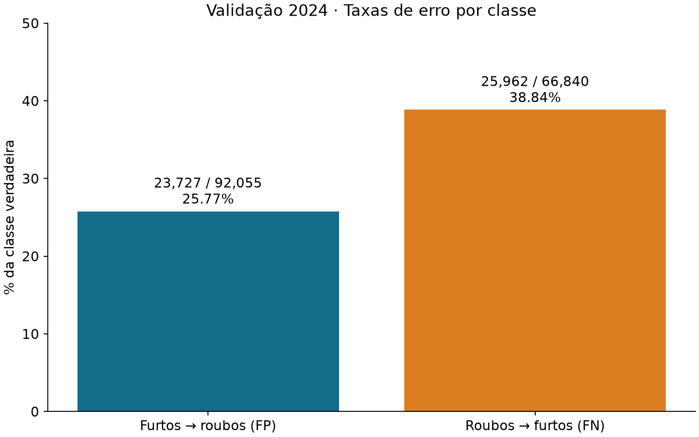
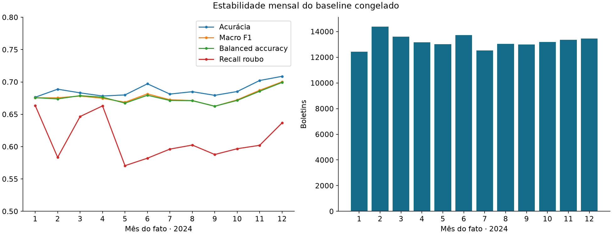
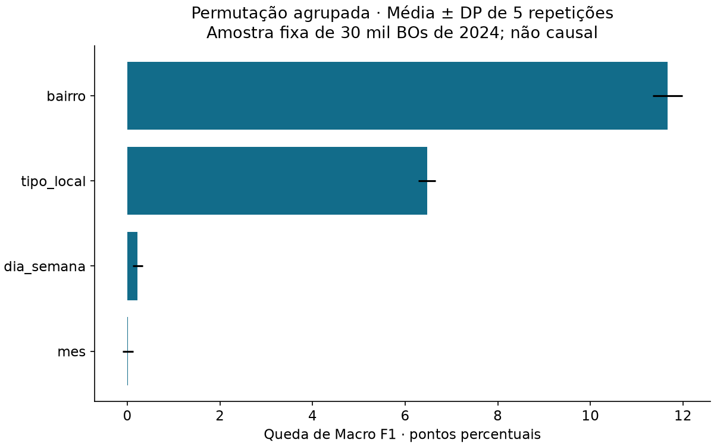
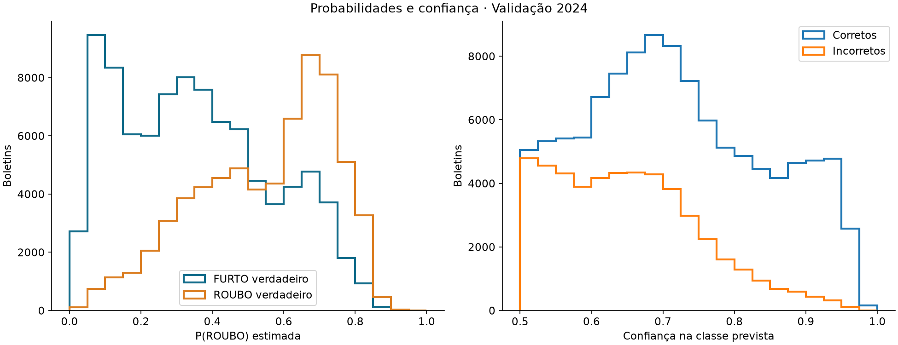
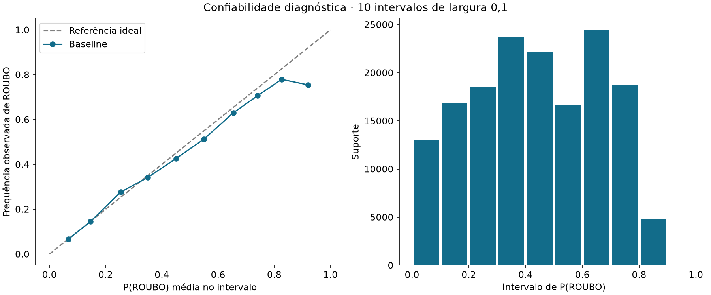
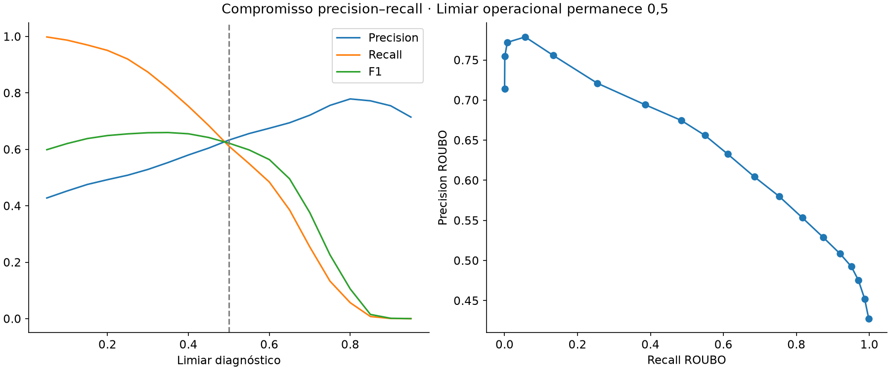

# Etapa 3 — Diagnóstico técnico da primeira MLP

## A. Integridade e protocolo

Baseline carregado: **299 → 64 ReLU → 1 sigmoid; 19.265 parâmetros**. Pré-processador original congelado: mês, dia da semana, tipo de local e bairro; nenhum período, natureza ou identificador como entrada. Threshold permanece **0,5**. Foram usados somente 190.124 BOs de 2023 e 158.895 de 2024. As novas análises não carregam 2025 para predição nem usam sua distribuição para decisões. Os testes legados consultam metadados/hashes para integridade e disjunção, sem avaliação preditiva desse ano.

117 arquivos anteriores conferidos por SHA256, sem alterações, incluindo modelo, pré-processador, datasets, scripts e relatórios. Alinhamento de 2023/2024 conferido por chave/índice e valores contra a base analítica. A matriz e as probabilidades de 2024 foram reproduzidas com tolerância 1e-7; qualquer divergência interrompe o diagnóstico. Não há novo ajuste do pré-processador. Evidências e tabelas completas em `etapa3/`.

## B. Análise dos erros

ROUBO é a classe positiva: **TN=68.328; FP=23.727; FN=25.962; TP=40.878**. São **49.689 erros**, exatamente os da Etapa 2. Taxa de falsos positivos entre furtos: **25.77%**; taxa de falsos negativos entre roubos: **38.84%**. Estes denominadores são as classes verdadeiras, não o total de erros.



`metricas_grupos.csv` detalha FP/FN, suportes, taxas por classe, média das probabilidades de FP/FN e Wilson 95% para taxa de erro por mês, dia, local, bairro, raridade e ausências. Destaque exige n≥200 e pelo menos 30 casos de cada classe; balanced accuracy fica indisponível se falta uma classe. Macro F1 usa sempre os dois rótulos, com divisões indefinidas explicitadas como zero. Categorias de bairro pequenas não são destacadas nem publicadas individualmente na tabela de desempenho. Intervalos são descritivos, não corrigem comparações múltiplas ou dependências residuais entre BOs.

A via pública reúne 44.884 erros (90,33% de todos os erros), mas também concentra grande parte do volume e uma mistura mais equilibrada de classes. A taxa de erro de 35,96% deve ser lida junto ao suporte, e não como indicador de segurança. Em `tipo_local` ausente, a rede prevê FURTO para todos os 4.653 registros e perde os 479 roubos desse grupo. Alta acurácia nesse grupo não representa capacidade de reconhecer as duas classes.

Condições de bairro (aprendidas no treino, sem novos agrupamentos):

| categoria | n | furtos | roubos | accuracy | macro_f1 | balanced_accuracy | recall_roubo | fpr | fnr |
| --- | --- | --- | --- | --- | --- | --- | --- | --- | --- |
| ausente | 521 | 167 | 354 | 0.7216890595009597 | 0.6331075010320293 | 0.6259684021786934 | 0.8926553672316384 | 0.6407185628742516 | 0.10734463276836158 |
| desconhecido | 355 | 130 | 225 | 0.7098591549295775 | 0.6153036854674957 | 0.6217094017094017 | 0.9511111111111111 | 0.7076923076923077 | 0.04888888888888889 |
| frequente | 145346 | 86672 | 58674 | 0.6886051215719731 | 0.6707423134299194 | 0.6685449706906109 | 0.5644067218870369 | 0.22731678050581502 | 0.43559327811296317 |
| raro_conhecido | 12673 | 5086 | 7587 | 0.6700860096267656 | 0.575910424947882 | 0.6004741641343687 | 0.9532094371952023 | 0.7522611089264648 | 0.04679056280479768 |

O bucket inclui **12.673 raros conhecidos + 355 novos = 13.028** BOs de validação. Em 2023 foram 14.244 raros, 247 bairros retidos e 1.913 nomes normalizados conhecidos. Há **247 nomes novos em 355 BOs de 2024**; não confundir quantidade de nomes com quantidade de registros. Os raros têm recall de roubo elevado, mas FPR muito maior que nos frequentes: o compartilhamento da representação pode favorecer uma classe e prejudicar outra. Essa comparação é observacional e as prevalências são diferentes; não prova que outro encoding melhoraria o resultado. O grupo novo tem suporte limitado e não autoriza conclusões sobre cada bairro. Nenhuma tabela constitui ranking de risco criminal.

## C. Generalização temporal, overfitting e underfitting

Histórico original: na época 5, loss=0.57411, val_loss=0.58467; na época 10, loss=0.56722, val_loss=0.58711. A queda de treino acompanhada da piora sustentada de validação após a melhor época é **compatível com sobreajuste incremental**; os melhores pesos já foram restaurados. O gap de acurácia dos pesos salvos é 70,15%−68,73%=1,42 ponto percentual. Esse gap isolado não identifica a causa; drift entre anos também pode contribuir. Curvas originais preservadas em `figures/curvas_mlp_baseline.png`.

Roubos passam de 44,03% no treino para 42,07% na validação. A distância de variação total entre distribuições categóricas é definida como metade da soma das diferenças absolutas de proporções, sobre a união dos níveis normalizados. É descritiva; não é teste de hipótese nem atribui causa.

| atributo | distancia_variacao_total | categorias_2023 | categorias_2024 | novas_2024 | registros_novos_2024 |
| --- | --- | --- | --- | --- | --- |
| mes | 0.01812989892246382 | 12 | 12 | 0 | 0 |
| dia_semana | 0.007601141166298925 | 7 | 7 | 0 | 0 |
| tipo_local | 0.057568487175362525 | 29 | 29 | 0 | 0 |
| bairro | 0.08735976532966672 | 1914 | 1812 | 247 | 355 |

Ausência de tipo de local por ano e classe:

| ano | atributo | classe | n | ausentes | taxa_ausencia |
| --- | --- | --- | --- | --- | --- |
| 2023 | tipo_local | 0 | 106421 | 12613 | 0.11851984100882344 |
| 2023 | tipo_local | 1 | 83703 | 1418 | 0.01694085038768025 |
| 2024 | tipo_local | 0 | 92055 | 4174 | 0.04534245831296507 |
| 2024 | tipo_local | 1 | 66840 | 479 | 0.007166367444643926 |

A ausência cai de 7,38% para 2,93% no total, mas permanece fortemente ligada ao rótulo dentro de cada ano. `OUTROS` sobe de **12/190.124 (0,0063%)** para **7.706/158.895 (4,85%)**, enquanto a ausência cai 4,45 pontos percentuais. Isso sugere investigar recodificação/preenchimento; **não prova que os mesmos registros migraram de categoria nem identifica um procedimento administrativo específico**. Não foram examinados identificadores de delegacia para tentar confirmar causalidade. A ausência pode refletir características do fato e do relato, além da coleta. O atributo não foi excluído nem declarado vazamento confirmado.

Todas as categorias de tipo de local de 2024 já eram conhecidas; a mudança principal é de frequências, não de vocabulário. Bairros novos atingem somente 355 registros, mas há mudança mais ampla de composição de bairros já conhecidos. Relações categoria/rótulo por ano estão em `relacoes_categoria_rotulo.csv`, e distribuições em `distribuicoes_anos.csv`.



| categoria | n | accuracy | macro_f1 | balanced_accuracy | recall_roubo |
| --- | --- | --- | --- | --- | --- |
| 1 | 12439 | 0.6763405418441997 | 0.675494877398612 | 0.6756428404277488 | 0.663538645282375 |
| 2 | 14393 | 0.6888070589870076 | 0.6755060991416629 | 0.673773899176191 | 0.5834305717619603 |
| 3 | 13596 | 0.6831421006178288 | 0.6782172572766607 | 0.6787968232203343 | 0.6465487929275756 |
| 4 | 13165 | 0.6782377516141284 | 0.6747720993666404 | 0.6764512136172312 | 0.6629882641443335 |
| 5 | 13016 | 0.6799323909035033 | 0.6686868070683432 | 0.6672461776825651 | 0.5705695083126989 |
| 6 | 13712 | 0.6971266044340724 | 0.6815673849570857 | 0.6794052710396485 | 0.5821294810058855 |
| 7 | 12537 | 0.6812634601579325 | 0.6724983462091673 | 0.6713624776051326 | 0.596178577990079 |
| 8 | 13048 | 0.6849325567136726 | 0.6712383924771175 | 0.6710798989920836 | 0.6024582293067026 |
| 9 | 12994 | 0.6793135293212251 | 0.6623685279517322 | 0.6624820940005567 | 0.5878378378378378 |
| 10 | 13176 | 0.6851851851851852 | 0.6723482762947022 | 0.6714748139505655 | 0.5967651979921919 |
| 11 | 13366 | 0.7022295376327996 | 0.687111688429995 | 0.685623257749819 | 0.6020541549953314 |
| 12 | 13453 | 0.708689511633093 | 0.7002295696386189 | 0.6992587872896219 | 0.6367296918767507 |

Acurácia mensal varia de 67.63% a 70.87%; recall de roubo de 57.06% a 66.35%. Não há deterioração monotônica; composição e prevalência variam. Trimestres e suportes constam na tabela completa. A rede não prevê a evolução do crime.

Ambiguidade dos atributos codificados:

| ano | tuplas_codificadas | tuplas_com_ambas_classes | teto_empirico_acuracia_mesmo_conjunto |
| --- | --- | --- | --- |
| 2023 | 31913 | 11791 | 0.7467126717300289 |
| 2024 | 30500 | 10978 | 0.7508102835205639 |

O “teto empírico” soma a classe mais frequente em cada tupla **do próprio conjunto**, sem treinar outro modelo. É um limite retrospectivo da acurácia determinística nesta amostra e representação, **não um limite Bayesiano populacional nem desempenho atingível em dados futuros**. Muitos contextos idênticos têm ambas as classes, inclusive antes de codificar. Não há evidência suficiente para diagnosticar underfitting de capacidade ou justificar simplesmente mais camadas.

## D. Influência aparente dos atributos

Permutação agrupada por campo original: amostra aleatória simples fixa de 30.000 BOs de 2024 (semente 314159), cinco embaralhamentos por campo, métricas comparadas ao baseline **na mesma amostra**. O pré-processador permanece congelado e cada permutação mantém uma categoria válida por atributo; não embaralha dummies independentes.

| atributo | delta_macro_f1_media | delta_balanced_accuracy_media | delta_accuracy_media | delta_macro_f1_dp |
| --- | --- | --- | --- | --- |
| mes | 0.00012156612196563276 | -6.6285612601246765e-06 | 0.00043333333333333 | 0.0011696679743555998 |
| dia_semana | 0.0022133274689665862 | 0.0018981508091912014 | 0.0028799999999999937 | 0.0011016497790114251 |
| tipo_local | 0.06472890262016365 | 0.06460156144943649 | 0.05888000000000002 | 0.0018378391766285932 |
| bairro | 0.11664847776174299 | 0.11574902530268305 | 0.10946666666666667 | 0.003197507886261515 |



Bairro tem a maior queda média de Macro F1 (~11,66 pontos percentuais), seguido de local (~6,47). Dia contribui pouco (~0,22) e mês fica próximo de zero (~0,01), dentro da variação das permutações. Não é evidência de que mês seja inútil em qualquer contexto. A permutação marginal quebra dependências e cria combinações bairro/local/tempo pouco plausíveis; pode distorcer a importância quando atributos são correlacionados. O DP de cinco permutações mede instabilidade do embaralhamento, não intervalo de confiança populacional. Importância preditiva não é causalidade e pesos da rede não foram usados como importância direta.

## E. Probabilidades, confiança e limiares

**Brier=0.200906; Log Loss=0.584672; ECE10=0.020581; ECE20=0.020829.** Brier da previsão constante com prevalência de treino: 0.244089. Brier é a média de (p−y)²; Log Loss penaliza probabilidades erradas com confiança alta. Ambas combinam discriminação e confiabilidade, portanto menor valor não prova melhor calibração isoladamente.

ECE é Σ(n_bin/N)·|média(p_bin)−frequência(ROUBO_bin)|, com 10 ou 20 intervalos de mesma largura em [0,1], fechados à esquerda e abertos à direita; o último inclui 1. Intervalos vazios não contribuem. `calibracao_bins.csv` registra limites e suportes. ECE depende da escolha dos intervalos e pode esconder erros de subgrupos. Nenhum calibrador foi ajustado.

P(ROUBO) média=0.4359, frequência observada=0.4207. Há leve superestimação média, sem evidência aqui de descalibração global extrema; a qualidade local não está garantida. Confiança é max(p,1−p); probabilidade da classe verdadeira usa p nos roubos e 1−p nos furtos.

| grupo | n | confianca_media | prob_classe_verdadeira_media | mediana_prob_roubo | n_confianca_ge_0.8 | n_confianca_ge_0.9 | n_confianca_ge_0.95 |
| --- | --- | --- | --- | --- | --- | --- | --- |
| todos | 158895 | 0.6982601881027222 | 0.6033074855804443 | 0.43421733379364014 | 34732 | 13105 | 2843 |
| corretos | 109206 | 0.7193909287452698 | 0.7193909287452698 | 0.39149388670921326 | 30358 | 12226 | 2725 |
| incorretos | 49689 | 0.65181964635849 | 0.3481804430484772 | 0.4884721636772156 | 4374 | 879 | 118 |
| FP | 23727 | 0.643943727016449 | 0.356056272983551 | 0.6453821659088135 | 1073 | 14 | 2 |
| FN | 25962 | 0.6590174436569214 | 0.340982586145401 | 0.35808610916137695 | 3301 | 865 | 116 |

Os erros têm confiança média **65,18%**; há **879 erros com confiança ≥90%**, dos quais **865 são falsos negativos**. Não interpretar os 879 como 879/49.689 de erro nos casos confiantes: entre todas as 13.105 previsões com confiança ≥90%, 879 erram (6,71%). Há erros individuais confiantes relevantes mesmo com ECE global moderado.





Foram calculados precision, recall, F1 e quantidade de previsões de roubo para limiares 0,05–0,95, em passos de 0,05. A curva mostra o compromisso entre recuperar roubos e aumentar falsos positivos. **Nenhum limiar foi selecionado ou substituído; o operacional continua 0,5.** Usar o mesmo 2024 para explorar, calibrar, escolher limiar e reportar um ganho final produziria estimativa otimista; a próxima etapa precisa de protocolo de desenvolvimento separado.

## F. Robustez da interface

Contrato confirmado: mês inteiro 1–12; dia inteiro 0–6 (segunda=0); ambos aceitam None. Local/bairro devem ser texto ou None. Strings numéricas de mês, floats, booleanos, NaN/inf, categorias numéricas e domínios inválidos são rejeitados previsivelmente. Entradas extras, inclusive período, alvo e chave, são recusadas pelo pré-processador. As probabilidades são finitas, estão em [0,1], somam 1 e seguem o limiar. Inferência recarrega os artefatos sem depender dos datasets.

Caixa, espaços e Unicode decomposto são normalizados. BRÁS/BRAS são equivalentes por alias explícito. Entretanto, **VIA PUBLICA sem acento não é igual a VIA PÚBLICA** no contrato atual: vira local desconhecido e usa a categoria ausente, com mudança possível de previsão. Isso é comportamento do baseline preservado, não correção aplicada. Tipos de local novos compartilham o fallback enviesado para FURTO observado na validação. Bairros novos compartilham o bucket raro. O texto de bairro `152` vira ausente silenciosamente, enquanto o número 152 é rejeitado: recomendar aviso/validação explícita em evolução futura da interface.

Outro limite: as categorias de ausência de mês/dia existem no encoder, mas **não foram observadas no treino**. A interface produz resposta finita para None, mas isso não valida cientificamente a resposta fora do suporte; os pesos dessas colunas não foram aprendidos com exemplos. Não alterar o baseline para corrigir esses pontos nesta etapa. Sondagens sintéticas, sem registros reais individuais, em `sondagens_inferencia.csv`.

## G. Estabilidade de treinamento

Três execuções adicionais foram concluídas, sem seleção de vencedor: controle com semente 42 e sementes 7/123. Mesma arquitetura, hiperparâmetros, pré-processador original e conjuntos completos. A ordem dos lotes usa RNG 42 em todas, reproduzindo o código original; varia a semente global da inicialização. PYTHONHASHSEED=42, determinismo TensorFlow habilitado, CPU e threads iguais, oneDNN desabilitado. Cada execução ocorre em processo separado.

| seed | epochs | best_epoch | seconds | accuracy | macro_f1 | balanced_accuracy | recall_roubo |
| --- | --- | --- | --- | --- | --- | --- | --- |
| 42 | 10 | 5 | 20.37483 | 0.68728 | 0.67766 | 0.67692 | 0.61158 |
| 7 | 10 | 5 | 17.36854 | 0.68694 | 0.67712 | 0.67630 | 0.60920 |
| 123 | 10 | 5 | 17.06238 | 0.68737 | 0.67773 | 0.67698 | 0.61148 |

| metrica | min | max | media | dp_amostral |
| --- | --- | --- | --- | --- |
| accuracy | 0.68694 | 0.68737 | 0.68720 | 0.00023 |
| macro_f1 | 0.67712 | 0.67773 | 0.67751 | 0.00034 |
| balanced_accuracy | 0.67630 | 0.67698 | 0.67673 | 0.00038 |
| recall_roubo | 0.60920 | 0.61158 | 0.61075 | 0.00134 |

Controle 42: diferença máxima de probabilidade em relação ao baseline=0.0000000000; reprodução dentro de 1e-7=True. A acurácia varia aproximadamente 68,694%–68,737%, com DP amostral de 0,023 ponto percentual. Essa pequena amostra sugere baixa sensibilidade à inicialização neste protocolo, mas não garante estabilidade em outra máquina, divisão ou conjunto. Não é busca de hiperparâmetros. Checkpoints em `models/experimentos_etapa3/`; baseline original intacto.

## H. Testes, preservação e reprodução

| arquivo | executados | falhas | erros | sucesso |
| --- | --- | --- | --- | --- |
| test_integridade.py | 8 | 0 | 0 | True |
| test_ml_pipeline.py | 15 | 0 | 0 | True |
| test_robustez_ml.py | 17 | 0 | 0 | True |

**40 testes efetivamente executados**, mantendo os 23 anteriores. Logs e falhas, se houver, em `etapa3/`. Os testes novos cobrem entradas adversas, caixa/acento, raros/novos/ausentes, probabilidades, determinismo de inferência, independência dos datasets, não mutação do pré-processador, hashes, matriz reproduzida, protocolo de sementes e bloqueio de 2025. Os testes estruturais não provam ausência absoluta de proxies ou vazamento indireto.

Na primeira passagem, grupos com uma única classe emitiram avisos de métricas indefinidas. A rotina foi explicitada: matriz sempre 2×2, Macro F1 com dois rótulos e balanced accuracy ausente quando falta uma classe; os agregados foram regenerados. Nenhum artefato anterior foi alterado. Não foram expostos BOs, identificadores, endereços ou exemplos individuais reais.

Com ambiente da Etapa 2 e PYTHONPATH=src, PYTHONHASHSEED=42:

```powershell
python -m diagnostics.analyze
python -m diagnostics.repeat_runs
python -m diagnostics.run_tests
python -m diagnostics.report
```

As repetições são opcionais ao apenas rever o relatório existente; reexecutar o comando treina novamente somente os três checkpoints experimentais. Dependências existentes em `requirements-ml.txt`. Notebook executado: `notebooks/03_diagnostico_mlp.ipynb`; scripts: `src/diagnostics/`. As tabelas são agregadas; não há novas previsões individuais exportadas nem frontend/API/dashboard.

## I. Recomendações priorizadas para a Etapa 4

| prioridade | problema | evidencia | hipotese | experimento | metrica | impacto_limitacoes |
| --- | --- | --- | --- | --- | --- | --- |
| 1 | Possivel proxy administrativo de tipo_local | Ausencia por classe desigual; OUTROS 12→7706; todos os 479 roubos com local ausente viram FN | Parte do ganho pode refletir coleta/recodificacao, alem do contexto do fato | Ablacao controlada com/sem tipo_local e comparacao por preenchimento, em dobras temporais de desenvolvimento | Macro F1, balanced accuracy, recall de roubo e FPR por grupo/mes | Avalia dependencia do atributo; perda preditiva nao prova que a informacao era vazamento |
| 2 | Bucket raro compartilha representacao com bairros novos | Raros conhecidos: recall roubo ~95%, FPR ~75%; desconhecidos n=355 em 247 nomes | O bucket aprende a mistura de classes e perde heterogeneidade geografica | Poucos limiares de frequencia predefinidos; vocabulario normalizado auditado; futuramente embedding com regularizacao | Macro F1, recall por classe, FPR, Brier por condicao de bairro e estabilidade temporal | Pode reduzir assimetria; embedding exige controle de capacidade e mais validacao; nao cria informacao ausente |
| 3 | Val_loss piora apos epoca 5 com train_loss em queda | val_loss 0.58467→0.58711; seeds proximas | Regularizacao pode ajudar mais que aumentar capacidade | Na Etapa 4, comparar arquitetura menor e regularizacao L2/dropout, mantendo protocolo e preprocessador | Macro F1, BCE, gap treino-validacao, variacao entre sementes e custo | Pode reduzir sobreajuste; drift e ambiguidade tambem limitam o ganho |
| 4 | Calibracao e erros confiantes nao uniformes | ECE10=0.0206; 879 erros com confianca≥0.9, 865 FN | Recalibracao pode melhorar probabilidades, nao necessariamente discriminacao | Calibracao em particao dedicada de desenvolvimento e protocolo de threshold com custos explicitados | Brier, log loss, ECE com 10/20 bins, confiabilidade por grupo; precision/recall | Nao usar os mesmos dados para calibrar, escolher limiar e estimar desempenho; nao abrir 2025 |
| 5 | Contribuicao temporal pequena e drift contextual | Permutacao: mes proximo de zero; dia pequeno; bairro/local dominam | Representacao temporal pode ser redundante ou fraca neste dominio | Ablacao mes/dia ou codificacao ciclica em dobras temporais; manter periodo_fato excluido | Macro F1, balanced accuracy, recall mensal e dispersao entre dobras | Ausencia de importancia marginal nao prova inutilidade; dependencias podem esconder contribuicao |
| 6 | Inferencia aceita valores sem suporte de treino e grafias novas | VIA PUBLICA sem acento vira ausente; mes/dia None ativam colunas nao observadas em 2023 | Fallback silencioso pode produzir respostas tecnicamente validas fora do suporte | Camada futura de validacao/avisos e aliases auditados; contrato explicito para ausencias temporais | Testes de contrato, cobertura de fallback, taxa de entradas fora de suporte | Melhora confiabilidade da interface; nao implica maior acuracia e nao altera o baseline nesta etapa |

Documento separado: `docs/recomendacoes_etapa4.md`. Priorizar investigação do proxy de local, representação/contrato de bairros e validação temporal antes de aumentar capacidade. Comparar regularização/arquitetura menor com hipótese explícita; não presumir que mais neurônios superarão ambiguidade. Nenhum desses experimentos foi iniciado.

Referências metodológicas: [calibração — scikit-learn](https://github.com/scikit-learn/scikit-learn/blob/main/doc/modules/calibration.rst), [permutação — scikit-learn](https://scikit-learn.org/stable/modules/permutation_importance.html), [EarlyStopping — Keras](https://keras.io/api/callbacks/early_stopping/). Consulta em 09/11/2026. Métricas e conclusões empíricas acima são calculadas localmente sobre os artefatos do projeto.

O diagnóstico se restringe a BOs elegíveis de **celulares subtraídos da capital**, não a todos os crimes e não a risco futuro. **2025 permanece fechado e o desenvolvimento termina na Etapa 3.**
