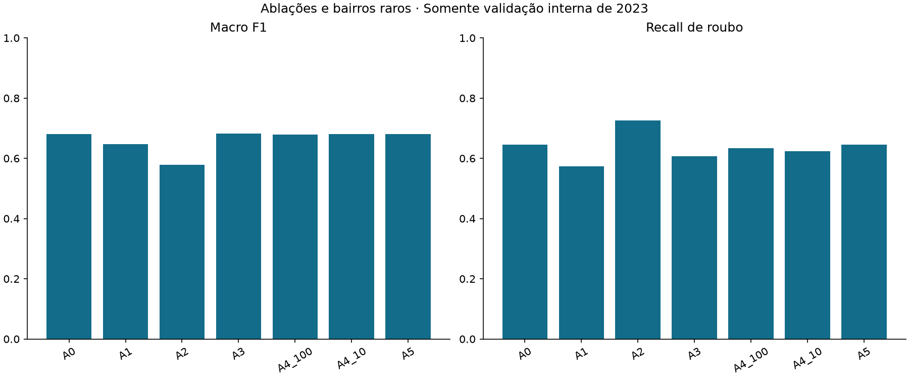
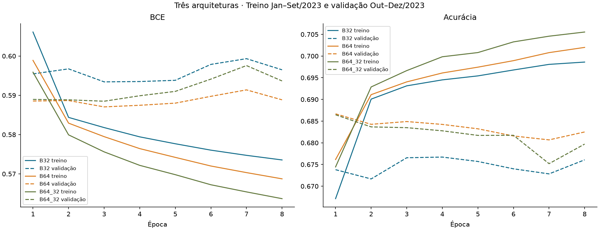
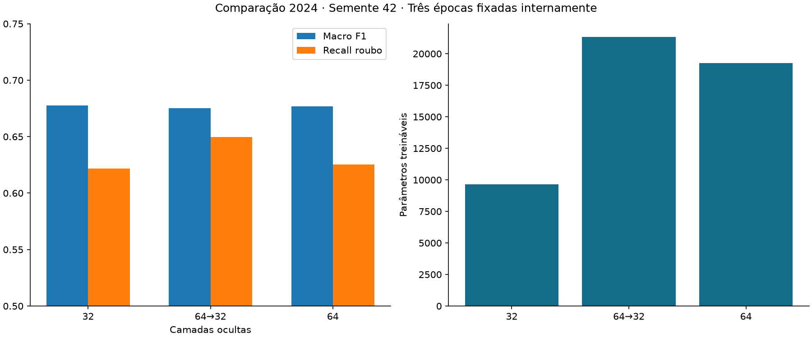
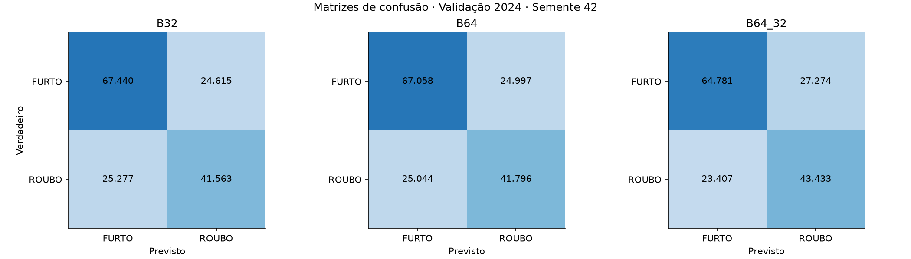
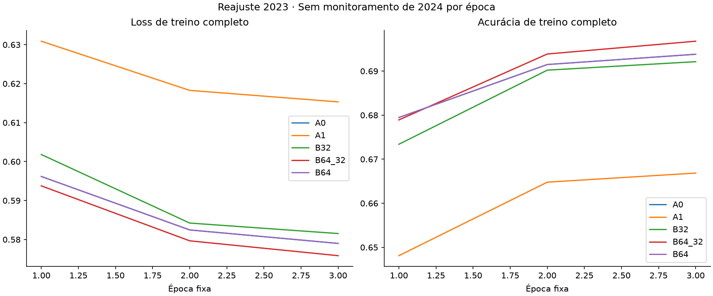
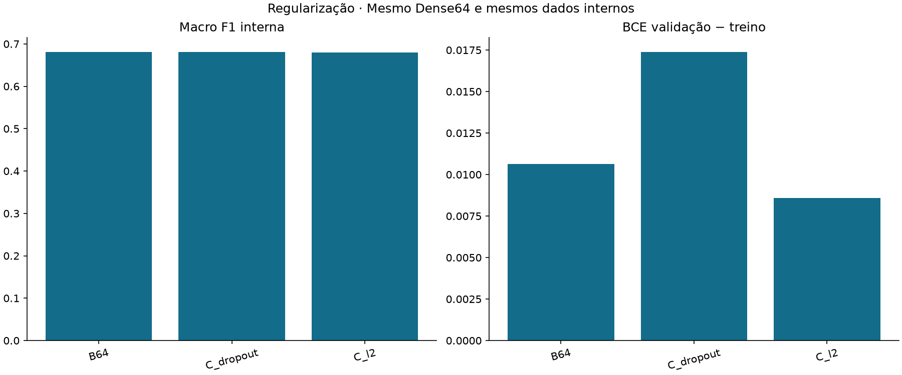
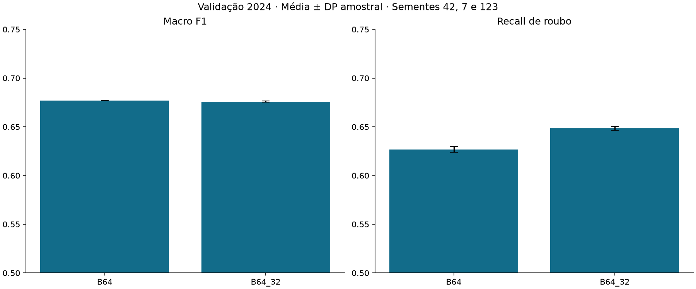

# Etapa 4 — Experimentação controlada e comparação de MLPs

## Escopo e protocolo

O domínio continua sendo BOs elegíveis com celulares subtraídos na capital; 0=FURTO, 1=ROUBO. Nenhuma previsão de crime futuro, aplicação web, calibrador ou avaliação de 2025 foi realizada. Artefatos anteriores preservados por SHA256: **168 arquivos**. As configurações originais, seus relatórios e seus 40 testes foram mantidos.

Matriz registrada antes de treinar: [matriz experimental](etapa4/matriz_planejada.json); [protocolo](../docs/protocolo_experimental_etapa4.md). São **25 registros de execução**, **23 treinamentos novos** e **2 reutilizações comprovadas** (A5 a partir de A0; B64 interno a partir de A5). Falhas efetivas registradas: **0**, em `falhas.jsonl` se houver. Configurações inferiores permanecem nas tabelas.

Treinamento interno: **144.697 BOs de janeiro–setembro/2023**, 81.128 furtos e 63.569 roubos. Validação interna: **45.427 de outubro–dezembro/2023**, 25.293 furtos e 20.134 roubos. Chaves únicas/disjuntas; ajuste de frequências/vocabulários somente no treino correspondente. Antes de B foram definidos os atributos; antes de 2024, candidatos e agenda completa foram congelados em `agenda_reajuste_congelada.json`.

Depois, os preprocessadores foram reajustados em **190.124 BOs de todo 2023**, com comparação em **158.895 de 2024**. Todas as redes reajustadas usaram **três épocas fixas**, escolhidas pela melhor época interna ou mediana das três sementes internas, sem monitorar 2024 por época. A limitação já conhecida de 2024 ter sido consultado em etapas anteriores permanece: ele é desenvolvimento/seleção, não teste independente. 2025 permanece reservado. Os testes legados usam metadados/hashes apenas para integridade.

Mês/dia recebem One-Hot nominal do domínio fixo do calendário, sem estatísticas do holdout. No recorte interno, meses 10/11/12 não têm exemplos de treinamento; seus pesos não aprendem efeitos. Isso limita a inferência sobre mês e a escolha de épocas, e não é vazamento nem justificativa para usar 2024 no orçamento. Bairros/local, frequências, aliases ativados e demais categorias vêm só do treino. Não há natureza, identificadores, período, indicadores extras de ausência ou dados pessoais nas entradas.

## A. Atributos e pré-processamento

Mesma Dense64, semente42, Adam0,001, batch256, BCE, ReLU/sigmoid, máximo30 épocas, EarlyStopping interno em val_loss com paciência5 e restauração dos melhores pesos. Threshold0,5. Os limites de frequência10/50/100 são definidos sem usar y. Ausências não removem BOs; desconhecidos mantêm fallbacks explícitos. CSR float32 é densificado apenas por lote.

| id | input_dimension | parameters | retained_bairros | train_rare_bucket | validation_rare_bucket | validation_unknown_bairros | macro_f1 | balanced_accuracy | recall_roubo | fp | fn | delta_macro_f1_pp | training_seconds |
| --- | --- | --- | --- | --- | --- | --- | --- | --- | --- | --- | --- | --- | --- |
| A0 | 267 | 17217 | 215 | 11910 | 4173 | 125 | 0.6808291307405228 | 0.680854900286532 | 0.645226979239098 | 7171 | 7143 | 0.0 | 8.66057519998867 |
| A1 | 238 | 15361 | 215 | 11910 | 4173 | 125 | 0.6477646199294143 | 0.6470262317238272 | 0.5734578325221019 | 7067 | 8588 | -3.3064510811108505 | 8.065414899989264 |
| A2 | 50 | 3329 | 0 | 0 | 0 | 0 | 0.5786361424736235 | 0.5951616803717626 | 0.7258865600476806 | 13546 | 5519 | -10.219298826689926 | 6.7429422000132035 |
| A3 | 254 | 16385 | 215 | 11910 | 4173 | 125 | 0.6821647478740092 | 0.6810304793333211 | 0.6064368729512268 | 6181 | 7924 | 0.13356171334863998 | 9.727099499985343 |
| A4_100 | 205 | 13249 | 153 | 16081 | 5570 | 125 | 0.6794270996543571 | 0.6791028830199857 | 0.6342505215059104 | 6982 | 7364 | -0.1402031086165656 | 7.937457100022584 |
| A4_10 | 671 | 43073 | 619 | 3848 | 1474 | 125 | 0.6813945255308467 | 0.6806734213784683 | 0.623870070527466 | 6640 | 7573 | 0.056539479032391426 | 9.412255500006722 |
| A5 | 267 | 17217 | 215 | 11910 | 4173 | 125 | 0.6808291307405228 | 0.680854900286532 | 0.645226979239098 | 7171 | 7143 | 0.0 | 0.0 |

| id | interpretacao |
| --- | --- |
| A0 | Referencia sob novo protocolo; nao substitui historico. |
| A1 | Retirar local reduz Macro F1 e recall gerais; melhora parte dos roubos sem local. Dependencia nao prova seguranca do atributo. |
| A2 | Retirar bairro causa a maior perda interna; recall sobe a custa de muitos falsos positivos. Nao avancou a 2024. |
| A3 | Pequeno ganho interno de Macro F1 com perda de 3,88 pp de recall; nao escolhido. Meses Q4 nao vistos limitam interpretacao. |
| A4_10 | Maior dimensao e menos raros; ganho de Macro F1 ~0,057 pp, sem ganho claro e recall menor. Nao avancou. |
| A4_100 | Menor dimensao; perde ~0,140 pp de Macro F1 interna. Sem beneficio preditivo demonstrado. |
| A5 | Matrizes identicas a A0; reutilizacao comprovada. Melhora somente contrato de acentuacao, sem ganho metrico alegado. |

**A1:** perda interna de ~3,31 pp de Macro F1 ao retirar local, mas isso não prova que local seja um atributo seguro. A comparação completa em 2024 também foi prevista para investigar os 479 roubos sem local. **A2:** a maior perda é sem bairro (~10,22 pp de Macro F1), com recall alto obtido por muitos FP; não se deve confundir recall isolado com ganho. **A3:** ganho de apenas +0,134 pp de Macro F1 com −3,879 pp de recall frente a A0. **A4:** 10 amplia dimensão267→671 e parâmetros17.217→43.073, sem ganho claro; 100 reduz dimensão para205 e perde um pouco de desempenho. São resultados de uma semente interna, não conclusões universais sobre os limiares.

**A5:** categorias de local foram revistas semanticamente nas etapas anteriores e no vocabulário de treino: a nova regra só reconhece equivalência de acentuação com correspondência unívoca a um nome visto. OUTROS e ausente continuam distintos; não houve inferência de recodificação entre anos. A0 e A5 têm matrizes codificadas idênticas em treino e validação interna; os pesos foram reutilizados, não retreinados, e não se alega ganho de métrica. `VIA PUBLICA` agora corresponde a `VIA PÚBLICA` no experimento, preservando o contrato histórico em seus próprios arquivos.

Decisão antes de B: **quatro atributos, frequência mínima50 e A5**. O desempate mecânico registrado na matriz apontou A3; houve revisão qualitativa documentada, porque o usuário exigiu não sacrificar substancialmente o recall por diferença mínima de Macro F1. A revisão ocorreu antes de B e de 2024, sem acrescentar tentativas. É uma intervenção de julgamento no desempate, não uma regra totalmente automática pré-registrada. A configuração original continua disponível.



## B. Comparação das três arquiteturas

Representação fixa A5 em todas. `comparacao_arquiteturas.csv` abaixo usa a mesma semente42 e os mesmos registros de 2024; todas têm299 entradas, três épocas fixas, threshold0,5 e nenhum ajuste em 2024. Valores em escala0–1, e deltas em pontos percentuais.

| id | architecture | parameters | epochs | training_seconds | accuracy | precision_roubo | recall_roubo | f1_roubo | precision_furto | recall_furto | macro_f1 | balanced_accuracy | brier | log_loss |
| --- | --- | --- | --- | --- | --- | --- | --- | --- | --- | --- | --- | --- | --- | --- |
| B32 | 32 | 9633 | 3 | 3.2137865999829955 | 0.6860064822681645 | 0.6280485962102209 | 0.6218282465589468 | 0.6249229427596266 | 0.727374699353948 | 0.732605507576992 | 0.677451837885561 | 0.6772168770679694 | 0.20140223315103842 | 0.5863302471642929 |
| B64_32 | 64→32 | 21313 | 3 | 3.623912200011546 | 0.6810409389848642 | 0.6142673285530429 | 0.6498055056852184 | 0.6315368564926898 | 0.7345784006894363 | 0.7037206018141329 | 0.6751776702141328 | 0.6767630537496756 | 0.2027196048864563 | 0.588850584716284 |
| B64 | 64 | 19265 | 3 | 3.3569315999920946 | 0.6850687560967935 | 0.625754195798961 | 0.6253141831238779 | 0.6255341120830933 | 0.7280840806931446 | 0.7284558144587475 | 0.676902006111324 | 0.6768849987913127 | 0.20160448847627263 | 0.5865684835774249 |

A tabela completa inclui melhor época interna, loss/accuracy, suporte, matriz, tempos, dimensões e hashes. 32, 64 e 64→32 foram efetivamente treinadas. A opcional128→64 foi omitida conforme orçamento prévio para priorizar regularização e evitar capacidade adicional sem hipótese forte.






As curvas com treino/validação são as internas de 2023. As curvas de reajuste completo mostram somente treino; 2024 foi avaliado após as três épocas, sem curvas de validação por época que pudessem orientar nova seleção do orçamento.

## C. Regularização e hiperparâmetros

Arquitetura de referência interna escolhida: Dense64. Dropout0,1 e L2=0,0001 foram testados separadamente; o restante permaneceu fixo. Com L2, o loss monitorado contém a penalidade; a BCE sem penalidade é calculada separadamente para comparação. Não interpretar a diferença de loss penalizado como diferença direta de qualidade probabilística.

| id | macro_f1 | balanced_accuracy | recall_roubo | brier | log_loss | train_bce | gap_bce | best_epoch | epochs | training_seconds |
| --- | --- | --- | --- | --- | --- | --- | --- | --- | --- | --- |
| B64 | 0.6808291307405228 | 0.680854900286532 | 0.645226979239098 | 0.2016424784522054 | 0.5870552784758206 | 0.5764109360689611 | 0.01064434240685952 | 3 | 8 | 0.0 |
| C_dropout | 0.6806834144918027 | 0.6817763223385879 | 0.6680242376080262 | 0.20247970272244575 | 0.5890381244580806 | 0.5716597845645501 | 0.017378339893530437 | 5 | 10 | 10.795176599989645 |
| C_l2 | 0.6796415446787711 | 0.6806892014700652 | 0.6660872156551108 | 0.2018412375125757 | 0.5875692540975926 | 0.5789962088171866 | 0.008573045280406033 | 3 | 8 | 8.399433899990981 |

Dropout não melhorou a Macro F1 e aumentou o gap de BCE. L2 reduziu o gap, mas não melhorou a BCE de validação nem Macro F1. Menor gap isolado não comprova melhor generalização. Nenhum regularizado avançou a reajuste em2024. O gatilho prévio para learning rate0,0005 não ocorreu (quatro variações consecutivas de val_loss superiores a0,01); portanto não houve essa tentativa. Dropout0,2 e busca exaustiva não foram executados.



## D. Estabilidade e comparação com o histórico

As duas configurações escolhidas internamente foram B64 e B64→32. Três sementes globais42/7/123, mantendo a ordem dos lotes RNG42. O determinismo TensorFlow está habilitado, CPU, threads4/1 e oneDNN desabilitado; ambiente e versões em `ambiente.json`. As sementes alteram inicialização e fontes aleatórias da rede, não a partição ou frequências. Não se escolheu a melhor semente para a recomendação.

| id | scope | metric | n_seeds | mean | sd | min | max |
| --- | --- | --- | --- | --- | --- | --- | --- |
| B64 | internal | macro_f1 | 3 | 0.6810523108177357 | 0.0004369843302313347 | 0.6807719846730591 | 0.6815558170396252 |
| B64 | internal | recall_roubo | 3 | 0.649846031588358 | 0.015116227640831037 | 0.6375782258865601 | 0.6667328896394159 |
| B64_32 | internal | macro_f1 | 3 | 0.6783852246267759 | 0.001149486086763519 | 0.6774687246348009 | 0.6796749426541364 |
| B64_32 | internal | recall_roubo | 3 | 0.6254097546438859 | 0.03832646681194752 | 0.5811562531042018 | 0.6479090096354425 |
| B64 | full | macro_f1 | 3 | 0.6770998373293823 | 0.00018284214421734156 | 0.676902006111324 | 0.677262614950384 |
| B64 | full | recall_roubo | 3 | 0.6268950728106922 | 0.0028950536088478275 | 0.6251346499102334 | 0.6302363853979653 |
| B64_32 | full | macro_f1 | 3 | 0.6759000870303581 | 0.0006811888617745396 | 0.6751776702141328 | 0.6765307462190074 |
| B64_32 | full | recall_roubo | 3 | 0.6485138639537203 | 0.0019223899152695494 | 0.6463046080191502 | 0.6498055056852184 |



Resumo de2024, usando média quando há três sementes:

| id | architecture | n_seeds | parameters | accuracy_mean | macro_f1_mean | macro_f1_sd | balanced_accuracy_mean | recall_roubo_mean | precision_roubo_mean | brier_mean | macro_delta_historico_pp |
| --- | --- | --- | --- | --- | --- | --- | --- | --- | --- | --- | --- |
| A0 | 64 | 1 | 19265 | 0.6850687560967935 | 0.676902006111324 |  | 0.6768849987913127 | 0.6253141831238779 | 0.625754195798961 | 0.20160448847627263 | -0.0762097336954648 |
| A1 | 64 | 1 | 17409 | 0.6555020611095378 | 0.643565240944735 |  | 0.6426449878677829 | 0.5616247755834829 | 0.5960747574511329 | 0.21812154908789932 | -3.409886250354366 |
| B32 | 32 | 1 | 9633 | 0.6860064822681645 | 0.677451837885561 |  | 0.6772168770679694 | 0.6218282465589468 | 0.6280485962102209 | 0.20140223315103842 | -0.021226556271769503 |
| B64 | 64 | 3 | 19265 | 0.6851337885605799 | 0.6770998373293823 | 0.00018284214421734156 | 0.6771576372508551 | 0.6268950728106922 | 0.6254587315559528 | 0.20162475894443455 | -0.05642661188963727 |
| B64_32 | 64→32 | 3 | 21313 | 0.6819241217995112 | 0.6759000870303581 | 0.0006811888617745396 | 0.677348380929479 | 0.6485138639537203 | 0.615777963748298 | 0.20254992628592175 | -0.17640164179205664 |

Baseline histórico: accuracy0,68728; Macro F1 0,67766; balanced accuracy0,67692; recall roubo0,61158. **O histórico usou2024 em EarlyStopping e restaurou época5; os novos modelos usam3 épocas sem EarlyStopping em2024.** A0 refaz a arquitetura original pelo protocolo novo e serve à comparação mais equivalente; A0 e B64 s42 produzem resultados iguais nos dados existentes, pois A5 muda apenas variantes de inferência, não as matrizes observadas.

Dense64 tem média de Macro F1 0.67710, DP 0.00018, diferença -0.056 pp do histórico. A rede profunda tem média 0.67590, maior recall e mais FP. Não há ganho consistente de Macro F1 sobre o histórico. A compacta32 aproxima esses resultados com metade dos parâmetros, mas só tem uma semente de reajuste; nenhuma nova tentativa foi acrescentada após ver2024. Diferenças mínimas, protocolos distintos e três sementes não sustentam alegações fortes de superioridade.

## E. Erros persistentes, probabilidades e robustez

Comparação semente42 com histórico:

| id | n | fp | fn | high_conf_errors | brier | log_loss |
| --- | --- | --- | --- | --- | --- | --- |
| Historico | 158895 | 23727 | 25962 | 879 | 0.20091 | 0.58467 |
| A0 | 158895 | 24997 | 25044 | 609 | 0.20160 | 0.58657 |
| A1 | 158895 | 25438 | 29301 | 49 | 0.21812 | 0.62654 |
| B32 | 158895 | 24615 | 25277 | 536 | 0.20140 | 0.58633 |
| B64_32 | 158895 | 27274 | 23407 | 608 | 0.20272 | 0.58885 |
| B64 | 158895 | 24997 | 25044 | 609 | 0.20160 | 0.58657 |

Os reajustes reduzem erros com confiança≥90%, mas ainda falham; isso pode refletir menor treinamento/confiança, não calibração comprovadamente melhor. Brier/Log Loss não superam consistentemente o histórico. Todas as probabilidades continuam sem calibrador e threshold0,5. Não foram escolhidos limiares individuais para favorecer redes.

Grupos com as mesmas definições da Etapa3 para a referência de frequência50:

| id | grupo | categoria | n | fp | fn | macro_f1 | balanced_accuracy | recall_roubo | fpr | high_conf_errors |
| --- | --- | --- | --- | --- | --- | --- | --- | --- | --- | --- |
| A0 | bairro_referencia_50 | desconhecido | 355 | 92 | 10 | 0.61762 | 0.62393 | 0.95556 | 0.70769 | 0 |
| A0 | bairro_referencia_50 | raro_conhecido | 12673 | 3838 | 348 | 0.57463 | 0.59976 | 0.95413 | 0.75462 | 0 |
| A0 | presenca_local | ausente | 4653 | 0 | 479 | 0.47287 | 0.50000 | 0.00000 | 0.00000 | 137 |
| A0 | presenca_local | preenchido | 154242 | 24997 | 24565 | 0.67255 | 0.67269 | 0.62983 | 0.28444 | 472 |
| A1 | bairro_referencia_50 | desconhecido | 355 | 130 | 0 | 0.38793 | 0.50000 | 1.00000 | 1.00000 | 0 |
| A1 | bairro_referencia_50 | raro_conhecido | 12673 | 5086 | 0 | 0.37448 | 0.50000 | 1.00000 | 1.00000 | 0 |
| A1 | presenca_local | ausente | 4653 | 1342 | 190 | 0.53052 | 0.64091 | 0.60334 | 0.32151 | 1 |
| A1 | presenca_local | preenchido | 154242 | 24096 | 29111 | 0.64452 | 0.64357 | 0.56132 | 0.27419 | 48 |
| B64 | bairro_referencia_50 | desconhecido | 355 | 92 | 10 | 0.61762 | 0.62393 | 0.95556 | 0.70769 | 0 |
| B64 | bairro_referencia_50 | raro_conhecido | 12673 | 3838 | 348 | 0.57463 | 0.59976 | 0.95413 | 0.75462 | 0 |
| B64 | presenca_local | ausente | 4653 | 0 | 479 | 0.47287 | 0.50000 | 0.00000 | 0.00000 | 137 |
| B64 | presenca_local | preenchido | 154242 | 24997 | 24565 | 0.67255 | 0.67269 | 0.62983 | 0.28444 | 472 |
| B64_32 | bairro_referencia_50 | desconhecido | 355 | 92 | 11 | 0.61530 | 0.62171 | 0.95111 | 0.70769 | 0 |
| B64_32 | bairro_referencia_50 | raro_conhecido | 12673 | 3845 | 341 | 0.57406 | 0.59953 | 0.95505 | 0.75600 | 0 |
| B64_32 | presenca_local | ausente | 4653 | 8 | 475 | 0.48075 | 0.50322 | 0.00835 | 0.00192 | 126 |
| B64_32 | presenca_local | preenchido | 154242 | 27266 | 22932 | 0.67046 | 0.67209 | 0.65444 | 0.31026 | 482 |

Nos 4.653 BOs sem local, A1 reduz os FN de479 para190 (recall de roubo 0%→60,33%), mas introduz **1.342 FP** entre4.174 furtos (FPR32,15%). Portanto, o atributo condiciona fortemente o padrão de erros e sua retirada troca erros, sem resolver a tarefa. A queda do desempenho geral ao remover local não elimina o risco de proxy administrativo. Em bairros raros/novos, A1 prevê ROUBO para todos os registros desses grupos: recall100% e FPR100%, evidência clara de que recall isolado seria enganoso.

Raros/novos continuam com elevada assimetria, mesmo nos candidatos: no B64 s42, 3.838 FP e348 FN entre12.673 raros conhecidos, FPR75,46%; entre355 novos, 92 FP e10 FN, FPR70,77%. Os grupos têm prevalências diferentes; as taxas não são rankings de segurança. Suporte mínimo de destaque: n≥200 e pelo menos30 exemplos de cada classe. Há apenas355 registros com bairros desconhecidos em2024; conclusões sobre cada nome isolado seriam frágeis.

`erros_subgrupos.csv` inclui todos os experimentos, grupos de referência50 e grupos próprios de cada limiar. Os de referência mantêm as mesmas populações para comparar limiares; os próprios mudam de composição e não devem ser comparados ingenuamente. `desempenho_mensal_2024.csv` registra estabilidade temporal com suportes e recalls. `resultados_experimentos.csv` contém gaps entre treino e validação, Brier/Log Loss e ECE10. A interação com coleta não foi transformada em causalidade.

A nova equivalência de acentuação de local é testada sem fundir OUTROS ou locais diferentes. Categorias desconhecidas e ausências têm fallback; limitações temporais e de bairros ainda existem. Dados com o mesmo contexto podem ter rótulos diferentes; mais parâmetros não recuperam informação ausente. O teto empírico da Etapa3 é retrospectivo da amostra, não limite matemático universal.

## F. Artefatos, testes e reprodução

| arquivo | executados | falhas | erros | sucesso |
| --- | --- | --- | --- | --- |
| test_integridade.py | 8 | 0 | 0 | True |
| test_ml_pipeline.py | 15 | 0 | 0 | True |
| test_robustez_ml.py | 17 | 0 | 0 | True |
| test_experimentos_ml.py | 17 | 0 | 0 | True |

**57 testes executados**, com os40 anteriores preservados. Verificações incluem partições e alinhamento, chaves, dados de ajuste, ausência de2025, entradas permitidas, hashes, compatibilidade/recarregamento de modelos, categorias novas, reprodução das métricas a partir das previsões, configuração estável entre sementes e integridade das tabelas. O carregador preditivo bloqueia2025; os testes antigos usam apenas verificações de integridade sobre seus metadados/hashes, sem predição ou métricas.

Artefatos locais: `models/experiments/etapa4/<run>/modelo.keras`, `preprocessador.joblib`, `config.json` e previsões locais em `.npz`, ignoradas pelo Git. Cada execução guarda configuração, assinatura, data UTC, versão dos dados por SHA256, sementes, épocas, tempo, histórico, métricas e caminhos. `runs/*.json` e `eventos.jsonl` preservam rastreabilidade; cache valida configuração e hashes antes de reutilizar. Relatórios públicos contêm agregados, sem BOs/identificadores ou exemplos reais individuais.

Reprodução, com o ambiente ML já configurado, PYTHONPATH=src e PYTHONHASHSEED=42:

```powershell
python -m experiments4.plan
python -m experiments4.run A
python -m experiments4.run BC
python -m experiments4.run refit
python -m experiments4.comparison
python -m experiments4.run_tests
python -m experiments4.report
```

Execuções válidas em cache não são retreinadas. O notebook `notebooks/04_experimentos_arquiteturas.ipynb` lê resultados e gráficos, sem disparar a bateria. As decisões são salvas entre blocos, antes do próximo nível. Ao reproduzir A, a revisão qualitativa do recall descrita no protocolo é aplicada de forma explícita e registrada.

## G. Candidatas para a Etapa5 — sem seleção definitiva

| id | role | result | model | preprocessor |
| --- | --- | --- | --- | --- |
| B64 | candidata principal, nao definitiva | reports/etapa4/runs/B64_full_s42.json | models/experiments/etapa4/B64_full_s42/modelo.keras | models/experiments/etapa4/B64_full_s42/preprocessador.joblib |
| B64_32 | alternativa: mais recall, mais falsos positivos | reports/etapa4/runs/B64_32_full_s42.json | models/experiments/etapa4/B64_32_full_s42/modelo.keras | models/experiments/etapa4/B64_32_full_s42/preprocessador.joblib |
| B32 | alternativa compacta exploratoria, somente uma semente completa | reports/etapa4/runs/B32_full_s42.json | models/experiments/etapa4/B32_full_s42/modelo.keras | models/experiments/etapa4/B32_full_s42/preprocessador.joblib |

# Recomendações para a Etapa 5

Não há vencedor definitivo. Nenhum dado de 2025 foi avaliado nesta etapa. Há **ganho limitado**, e não evidência de que mais capacidade resolva a tarefa.

## Candidatas e evidências

- Principal experimental: **B64 / Dense64**, quatro atributos, limiar50, alias inequívoco de acentuação de local. Três épocas fixas escolhidas internamente. Média de três sementes: Macro F1=0.67710 (DP 0.00018), balanced accuracy=0.67716, recall roubo=0.62690. Diferença de Macro F1 contra histórico: -0.056 pp; não é ganho comprovado.
- Alternativa com prioridade em recall: **B64_32 / Dense64→32**, Macro F1=0.67590, recall=0.64851; mais FP e parâmetros. Só faz sentido se esse compromisso for aceito; profundidade não produziu melhoria geral.
- Alternativa compacta: **B32**, 9.633 parâmetros. Macro F1 de uma semente completa ~0,67745, próximo dos demais. Não se pode afirmar superioridade ou estabilidade com uma semente; sua simplicidade merece consideração, sem acrescentar tentativas nesta etapa após ver 2024.
- Preservar o baseline histórico como opção de referência: Macro F1 0,67766, com EarlyStopping em 2024. Seu protocolo difere e a vantagem numérica pequena não é comparação imparcial de otimização.

## Antes de abrir 2025

1. Fixar a configuração final e o tratamento de ausências/novos/acentuação. Não transformar OUTROS em ausente; a relação de local com coleta continua sem confirmação semântica externa. A ablação mostra dependência e troca de erros, não prova causalidade ou ausência de vazamento.
2. Revisar a robustez dos buckets raros: mesmo com quatro atributos e limiar50, raros/novos seguem com FPR alto. Não inferir risco de bairros. Mudanças de representação adicionais exigem protocolo de desenvolvimento explícito e não usar 2025.
3. Decidir o orçamento final sem ajustá-lo ao teste. O recorte Jan–Set vs Q4 contém meses não observados no treino; três épocas foram uma escolha conservadora e podem limitar o reajuste. Não recomendar mais épocas apenas porque o histórico usou cinco e teve métrica ligeiramente maior.
4. Se calibrar ou escolher threshold, separar ajuste e verificação em dados de desenvolvimento; não usar os mesmos exemplos para afirmar melhoria imparcial. Os três epochs refits têm ECE/Brier que não superam consistentemente o histórico. Manter 0,5 até esse protocolo ser aprovado. Probabilidades não são risco futuro de crime.
5. Critérios finais: Macro F1 principal, balanced accuracy, recall/precision por classe, FP/FN, Brier/Log Loss, confiabilidade por suporte, grupos ausentes/raros/novos e custo. Não escolher pela melhor semente. Definir também os custos de FP/FN, hoje não fornecidos.
6. Após congelar modelo/pré-processador/threshold e protocolo de calibração, avaliar 2025 **uma única vez** para estimativa final. Não resolver empates nem refazer arquitetura com base nesse resultado. A Etapa 5 depende de autorização do usuário.

Artefatos por candidato: `reports/etapa4/candidatos_artefatos.json`. Todos os checkpoints e preprocessadores estão em `models/experiments/etapa4/`, sem promover qualquer arquivo a `mlp_baseline.keras`.


O resultado acadêmico é uma comparação controlada com **benefício limitado de capacidade e regularização**, não uma promessa de aumento de acurácia. O baseline histórico, datasets e documentos anteriores continuam intactos. **2025 não foi avaliado. O desenvolvimento termina na Etapa4.**
