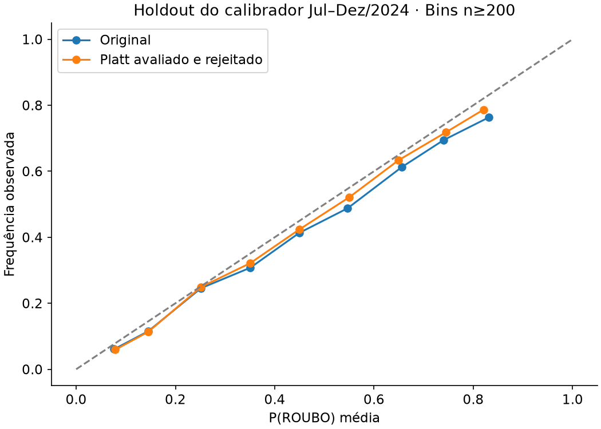
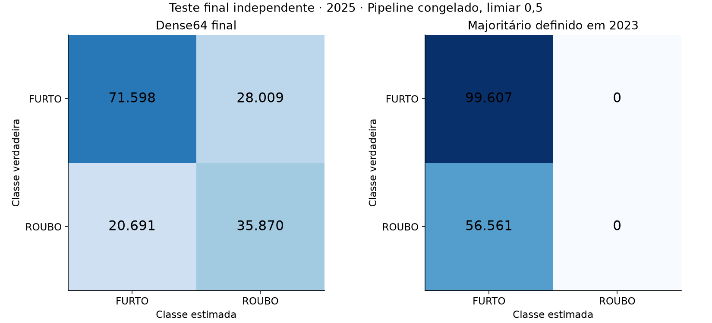
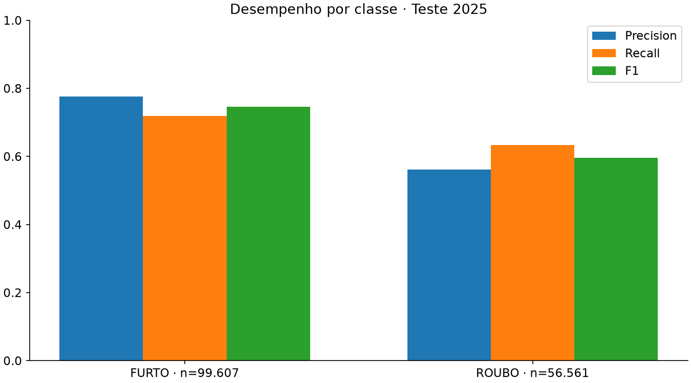
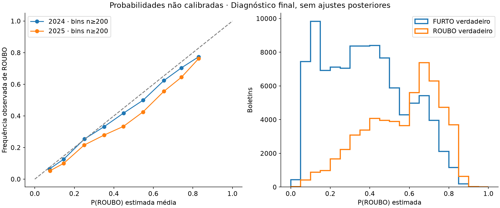
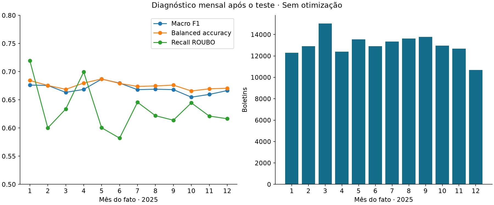

# Etapa 5 — Seleção, congelamento e avaliação final da MLP

## A. Modelo selecionado

**gs-celulares-sp-dense64-v1.0.0: Dense64, origem B64_full_s42.** Quatro entradas, na ordem `mes`, `dia_semana`, `tipo_local`, `bairro`; 299 colunas One-Hot; uma camada Dense64 ReLU e uma saída sigmoid; **19.265 parâmetros**. Adam0,001, BCE, batch256, três épocas, semente42 e ordem dos lotes42; sem dropout/L2. Frequência mínima50 para bairros, 247 frequentes retidos e equivalência unívoca de acentuação de local, `local_alias=True`.

A seleção foi definida pelo usuário antes de2025, com base na estabilidade em três sementes, desempenho semelhante das alternativas e ausência de ganho consistente de maior capacidade. Dense32 permanece alternativa compacta, e64→32 alternativa de maior recall com mais FP. Não houve novo treino nem seleção de semente nesta etapa. O baseline histórico e os experimentos anteriores foram preservados.

As regras são exatamente as do objeto experimental: NFC, espaços/maiúsculas, aliases de bairro ativos no treino, correspondência unívoca de acentuação de local, `OUTROS` separado de ausência, local novo representado como ausente e bairros raros/novos no bucket treinado. Não há natureza, rubrica, chave, ano, hora, período, indicador administrativo adicional ou informação pessoal nas entradas.

## B. Congelamento e integridade

Modelo e pré-processador originais foram conferidos pelos hashes experimentais e copiados sem mudanças para `models/final/`. Todas as158.895 probabilidades de2024 foram reproduzidas; diferença absoluta máxima=0.0000000000. Macro F1 reproduzida=0.676902, compatível com67,69% da Etapa4. Dimensões, ordem das299 colunas, rótulos e efeitos de aliases foram verificados.

Congelamento registrado em **2026-11-09T19:42:06.159595-03:00**, horário de São Paulo. Manifesto: `../models/final/manifesto.json`; SHA256=`b992412335c69623bdf63c9341cefaa82e0a81ae73d7d32e110f2498faa8c532`. Modelo SHA256=`dadad1326e6ae58d0f26f7e69638a9283d46863c9ecb7d56e76e037b4940091c`; pré-processador SHA256=`b8b3cd3662505b872b5e6d34296fba53a5b1ce5e065811d128f0423aa050a524`. O manifesto registra arquitetura, hiperparâmetros, regras, categorias, rótulos, código necessário à inferência, versões, fonte, protocolo e limitações. Sidecar `manifesto.sha256` permite verificar sua integridade.

Os75 testes prévios foram aprovados antes de abrir2025 para inferência. A avaliação começou em `2026-11-09T22:46:11.641021+00:00` UTC, com inferência em `2026-11-09T22:46:16.220635+00:00` UTC, depois do congelamento. Há **uma única chamada planejada de inferência em lotes**, sobre todos os156.168 registros. O registro `etapa5/avaliacao_unica.json` impede outra inferência silenciosa e valida hashes de resultados quando chamado novamente. Os testes posteriores usam apenas probabilidades salvas.

Arquivos das quatro etapas anteriores intactos por SHA256: **344**. Dataset de teste conferido contra a definição da Etapa1 por chave/índice, alvo, data do fato e município3550308: zero divergências,156.168 chaves únicas e nenhuma chave em anos diferentes. Os hashes dos datasets processados são os registrados no experimento escolhido. Nenhuma transformação foi reajustada em2025.

## C. Decisão de calibração — tomada antes do teste

Protocolo e limites quantitativos foram registrados em `etapa5/protocolo_previo.json` antes do ajuste. Uma única regressão logística de Platt sobre logit da sigmoid, clip1e-7, C=1e6, lbfgs, max_iter1000, tol1e-10, random_state42. Ajuste em **80.321 registros Jan–Jun/2024** e verificação em **78.574 Jul–Dez/2024**. A rede não mudou. Não houve busca de thresholds nem segundo método.

Para adotar: reduzir Brier≥0,001 e Log Loss≥0,002; ECE10/20 não piorar mais que0,002; Macro F1 perder no máximo0,005; recall perder no máximo0,01; inclinação positiva e ausência de piora probabilística relevante em Q3/Q4. Todos os critérios eram necessários.

| versao | n | brier | log_loss | ece10 | macro_f1 | recall_roubo |
| --- | --- | --- | --- | --- | --- | --- |
| sigmoid_original | 78574 | 0.20035566638901003 | 0.5834875511861909 | 0.03809146443970991 | 0.6774739408937513 | 0.6332482569721115 |
| platt_candidato | 78574 | 0.19928582877453618 | 0.5810872980813029 | 0.02290652118710917 | 0.677063948422375 | 0.5983876992031872 |

**Calibração rejeitada.** O ganho probabilístico foi consistente pelos limites definidos, mas o recall caiu **3.49 pp**, excedendo1pp. Houve2.508 mudanças de classificação em H2 com threshold0,5. A decisão manteve a sigmoid original e não foi criado `calibrador.joblib` final. Os coeficientes candidatos constam do diagnóstico, não participam da inferência final. Não foi calculado resultado calibrado de2025 para reconsiderar a decisão.



2024 já havia participado da escolha de arquiteturas e diagnósticos. H2 é holdout do calibrador, mas não é independente de todas as decisões do projeto; a avaliação independente permaneceu2025.

## D. Resultado final independente — 2025

Distribuição real: **99,607 FURTOS (63.78%)** e **56,561 ROUBOS (36.22%)**, total **156,168**. Classe positiva=ROUBO.

| metrica | resultado_2025 |
| --- | --- |
| accuracy | 0.688156 |
| precision_roubo | 0.561530 |
| recall_roubo | 0.634183 |
| f1_roubo | 0.595649 |
| precision_furto | 0.775802 |
| recall_furto | 0.718805 |
| f1_furto | 0.746217 |
| macro_f1 | 0.670933 |
| balanced_accuracy | 0.676494 |
| brier | 0.200547 |
| log_loss | 0.583506 |
| ece10 | 0.080964 |
| ece20 | 0.081009 |

| classe | suporte | previsoes | precision | recall | f1 |
| --- | --- | --- | --- | --- | --- |
| FURTO | 99607 | 92289 | 0.775802 | 0.718805 | 0.746217 |
| ROUBO | 56561 | 63879 | 0.561530 | 0.634183 | 0.595649 |

**Matriz: TN=71,598; FP=28,009; FN=20,691; TP=35,870.** As linhas são classes verdadeiras e colunas previstas, na ordem FURTO, ROUBO. Total de erros=48,700; FPR entre furtos=28.12%; FNR entre roubos=36.58%.




Referência majoritária compatível: classe FURTO definida no treino2023 (106.421 furtos contra83.703 roubos), sem consultar o teste para escolher a classe. Probabilidade constante de roubo=83.703/190.124, também do treino, usada apenas para métricas probabilísticas da referência. No teste: accuracy=0.637820; Macro F1=0.389432; balanced accuracy=0,5 e recall roubo=0. A Dense64 supera a referência em **5.03 pp de acurácia** e **28.15 pp de Macro F1**, sem confundir acurácia com desempenho equilibrado.

IC95% das métricas principais:

| metrica | lower | upper | point |
| --- | --- | --- | --- |
| accuracy | 0.685857 | 0.690436 | 0.688156 |
| macro_f1 | 0.668499 | 0.673307 | 0.670933 |
| balanced_accuracy | 0.674057 | 0.678904 | 0.676494 |
| recall_roubo | 0.630126 | 0.638121 | 0.634183 |

10.000 réplicas IID não paramétricas da distribuição conjunta das quatro células(y,pred), via multinomial, seed12345, percentis2,5 e97,5. Para métricas de matriz fixa, equivale a reamostrar BOs. Intervalos condicionais ao pipeline, sem variabilidade de treinamento/seleção e sem corrigir dependências residuais ou mudança temporal; não são garantia de desempenho em outra população.

## E. Generalização: 2024 versus 2025

| metrica | validacao_2024 | teste_2025 | diferenca_2025_menos_2024 |
| --- | --- | --- | --- |
| accuracy | 0.685069 | 0.688156 | 0.003088 |
| precision_roubo | 0.625754 | 0.561530 | -0.064224 |
| recall_roubo | 0.625314 | 0.634183 | 0.008868 |
| f1_roubo | 0.625534 | 0.595649 | -0.029885 |
| precision_furto | 0.728084 | 0.775802 | 0.047718 |
| recall_furto | 0.728456 | 0.718805 | -0.009651 |
| f1_furto | 0.728270 | 0.746217 | 0.017947 |
| macro_f1 | 0.676902 | 0.670933 | -0.005969 |
| balanced_accuracy | 0.676885 | 0.676494 | -0.000391 |
| brier | 0.201604 | 0.200547 | -0.001057 |
| log_loss | 0.586568 | 0.583506 | -0.003062 |
| ece10 | 0.027147 | 0.080964 | 0.053817 |
| ece20 | 0.027337 | 0.081009 | 0.053672 |

A prevalência de roubo caiu de **42.07%** para **36.22%**. A acurácia subiu +0.31 pp, mas Macro F1 mudou -0.60 pp, balanced accuracy -0.04 pp e recall roubo +0.89 pp. A precision de roubo caiu -6.42 pp. A queda de prevalência e a mudança de contexto são hipóteses consistentes com essa combinação, não causas demonstradas.

**A confiabilidade probabilística piorou:** ECE10 passou de 2.71% para **8.10%**. P(ROUBO) média=0.4431, acima da frequência real=0.3622. Brier/Log Loss ficaram ligeiramente menores, mas essas medidas combinam confiabilidade, discriminação e incerteza da população; sua redução não demonstra melhora de calibração. A mudança de prevalência altera sua interpretação. As probabilidades continuam estimadas e não calibradas; **nenhum ajuste foi feito após observar essa piora**.



As curvas de confiabilidade exibem somente intervalos com pelo menos200 exemplos, evitando destacar taxas instáveis nas caudas. ECE10/20 e demais métricas incluem todos os registros e intervalos; suportes constam nas tabelas de bins. Essa restrição é apenas visual, sem alteração do pipeline ou dos resultados do teste.

Mudanças de distribuição normalizada:

| atributo | total_variation | levels_2024 | levels_2025 | new_vs_2024_levels | new_vs_2024_records |
| --- | --- | --- | --- | --- | --- |
| mes | 0.034119907554842475 | 12 | 12 | 0 | 0 |
| dia_semana | 0.010554693359659688 | 7 | 7 | 0 | 0 |
| tipo_local | 0.03555201123840357 | 29 | 29 | 0 | 0 |
| bairro | 0.06769358506668004 | 1812 | 1803 | 257 | 409 |

Tipo de local ausente passou de4.653/158.895 (2,93%) para **68/156.168 (0,044%)**. Em2025 são34 furtos e34 roubos sem local, contra4.174 furtos e479 roubos em2024. É uma mudança expressiva de preenchimento; não foi usada para retocar o modelo e não prova recodificação específica. OUTROS contém11.901 registros em2025, acima dos7.706 de2024. Tipos de local novos em relação ao treino:0. Bairros desconhecidos do treino:389 registros, contra355 em2024; raros e novos continuam compartilhando representação. A tabela de drift compara níveis2024/2025, enquanto o contador desconhecido do pré-processador se refere a2023 — denominadores distintos.

## F. Análise dos erros finais — apenas diagnóstica

Há **28,009 FP** e **20,691 FN**. **458 erros têm confiança≥90%**, sendo **439 FN**. Confiança média dos erros=64.56%. As previsões estimam63,879 roubos, diante de56,561 verdadeiros. Confiança na classe prevista=max(p,1−p), diferente de p para roubo.

Locais com maior número absoluto de erros entre os de suporte suficiente:

| categoria | n | furtos | roubos | fp | fn | macro_f1 | balanced_accuracy | recall_roubo | high_conf_errors |
| --- | --- | --- | --- | --- | --- | --- | --- | --- | --- |
| VIA PÚBLICA | 122014 | 69538 | 52476 | 27575 | 17022 | 0.6334496224399996 | 0.6395386842369399 | 0.675623142007775 | 19 |
| TERMINAL/ESTAÇÃO | 16491 | 14797 | 1694 | 6 | 1688 | 0.4764355306092248 | 0.501568212516992 | 0.0035419126328217238 | 210 |
| OUTROS | 11901 | 10936 | 965 | 1 | 965 | 0.47884918549658434 | 0.49995427944403803 | 0.0 | 212 |
| RESIDÊNCIA | 1035 | 742 | 293 | 36 | 285 | 0.4311249081796716 | 0.4893931170252891 | 0.027303754266211604 | 0 |
| ESTACIONAMENTO/GARAGEM | 879 | 496 | 383 | 195 | 99 | 0.6654038573085848 | 0.6741845995114967 | 0.741514360313316 | 0 |
| COMÉRCIO E SERVIÇOS | 633 | 458 | 175 | 100 | 108 | 0.5833523201944254 | 0.5822582657517156 | 0.38285714285714284 | 0 |
| RODOVIA/ESTRADA | 540 | 397 | 143 | 19 | 124 | 0.5254395614525654 | 0.5425040954008208 | 0.13286713286713286 | 0 |
| RESTAURANTE E AFINS | 493 | 406 | 87 | 24 | 80 | 0.4994141997969226 | 0.5106732348111658 | 0.08045977011494253 | 0 |

Via pública concentra grande volume e sobreposição de classes; OUTROS e terminal/estação têm muitos roubos classificados como furtos. Isso descreve o classificador, não causalidade criminal. Grupos com pelo menos200 BOs e30 de cada classe são destacados; grupos menores, como local ausente(n=68), não sustentam conclusões gerais.

| categoria | n | furtos | roubos | fp | fn | macro_f1 | balanced_accuracy | recall_roubo |
| --- | --- | --- | --- | --- | --- | --- | --- | --- |
| ausente | 540 | 210 | 330 | 137 | 35 | 0.6166988560392215 | 0.6207792207792208 | 0.8939393939393939 |
| desconhecido | 389 | 163 | 226 | 126 | 10 | 0.5564721663313212 | 0.5913730387100277 | 0.9557522123893806 |
| frequente | 142253 | 92921 | 49332 | 23198 | 20331 | 0.6666889553670025 | 0.669110532805059 | 0.5878739965945026 |
| raro_conhecido | 12986 | 6313 | 6673 | 4548 | 315 | 0.5719758447147414 | 0.616188330099553 | 0.9527948448973476 |

Raros conhecidos:12.986; desconhecidos:389; frequentes:142.253; bairro ausente:540. O recall elevado nos buckets raros/novos acompanha muitos falsos positivos: não é desempenho equilibrado. Nenhum ranking individual de bairro ou indicador de segurança foi construído.

| categoria | n | fp | fn | macro_f1 | recall_roubo | destacar |
| --- | --- | --- | --- | --- | --- | --- |
| ausente | 68 | 0 | 34 | 0.3333333333333333 | 0.0 | False |
| preenchido | 156100 | 28009 | 20657 | 0.6710382456190935 | 0.6345640136571904 | True |

Desempenho mensal e suporte:

| categoria | n | accuracy | macro_f1 | balanced_accuracy | recall_roubo |
| --- | --- | --- | --- | --- | --- |
| 1 | 12288 | 0.6783854166666666 | 0.6762152658088214 | 0.6843570110347441 | 0.719332679097154 |
| 2 | 12918 | 0.6931413531506425 | 0.6755246712750778 | 0.6755380805560973 | 0.6000403795679387 |
| 3 | 15042 | 0.6777024331870762 | 0.6632323363682175 | 0.6686889695446834 | 0.6337094751925488 |
| 4 | 12409 | 0.6751551293416069 | 0.6685325604852771 | 0.6798115883278444 | 0.6994720168954593 |
| 5 | 13549 | 0.7114916229980073 | 0.6868037864170592 | 0.6870166716632875 | 0.6004115226337449 |
| 6 | 12904 | 0.7071450712957222 | 0.6797360685921863 | 0.6791939925572172 | 0.5820278503046127 |
| 7 | 13334 | 0.6808159592020399 | 0.6680791702961868 | 0.673814747500491 | 0.6456960255642101 |
| 8 | 13620 | 0.6906754772393539 | 0.668844723599556 | 0.6747015998961196 | 0.6218434343434344 |
| 9 | 13784 | 0.6979831688914684 | 0.6681482852981108 | 0.6761105578717947 | 0.6138702460850112 |
| 10 | 12959 | 0.6721969287753685 | 0.6547267617794794 | 0.6657226106270417 | 0.6445729537366548 |
| 11 | 12673 | 0.686183224177385 | 0.659624583708792 | 0.6695135911474126 | 0.6212048192771085 |
| 12 | 10688 | 0.6856287425149701 | 0.6664320003424138 | 0.6706272345321227 | 0.6164596273291926 |



As diferenças entre meses podem refletir composição e prevalência, sem identificar causa ou prever ocorrências futuras. Esses resultados não alteraram pesos, vocabulários, frequências, threshold, calibração ou escolha de arquitetura.

## G. Robustez e contrato de inferência

Interface: `from final5.pipeline import FinalPipeline`; carregar uma vez e chamar `classificar(mes,dia_semana,tipo_local,bairro)`. Retorna classe/código, probabilidades de furto/roubo, versão **gs-celulares-sp-dense64-v1.0.0**, `probabilidades_calibradas=False` e avisos estruturados. A inferência funciona sem XLSX/Parquet ou rótulos. A mesma transformação do treinamento é usada, sem reimplementação.

Mês inteiro1–12, dia inteiro0–6 (segunda=0), texto/None para local e bairro. Tipos errados, booleanos, NaN/inf, valores fora de domínio e atributos extras são recusados. Caixa/espaços e variantes de acento permitidas são consistentes. Ausentes, raros e novos geram avisos. Mês/dia None ativam categorias sem exemplos de treino e produzem aviso específico. Bairro textual sem letras mantém a conversão original para ausente com aviso; número tipado é rejeitado. O objeto não aceita silenciosamente valores inválidos. Detalhes em `../docs/contrato_inferencia.md` e no contrato congelado `../models/final/contrato.json`.

Limites de uso: (1) registros históricos de celulares subtraídos; (2) somente São Paulo capital; (3) não prevê crime futuro; (4) não determina natureza jurídica; (5) contexto não separa perfeitamente todas as ocorrências; (6) possíveis efeitos administrativos; (7) sensibilidade à distribuição; (8) demonstração acadêmica sem validação para decisões policiais ou operacionais reais. Não é sistema oficial de segurança pública.

## H. Testes e rastreabilidade

| suite | executados | falhas | erros | sucesso |
| --- | --- | --- | --- | --- |
| test_integridade | 8 | 0 | 0 | True |
| test_ml_pipeline | 15 | 0 | 0 | True |
| test_robustez_ml | 17 | 0 | 0 | True |
| test_experimentos_ml | 17 | 0 | 0 | True |
| test_modelo_final.FinalPre | 18 | 0 | 0 | True |
| test_modelo_final.FinalPost | 8 | 0 | 0 | True |

**83 testes efetivamente executados e aprovados**, zero falhas/erros:75 prévios (57 existentes+18 novos) e8 posteriores. Os posteriores recalculam métricas e intervalos a partir do arquivo privado salvo, verificam hashes/manifesto e testam o bloqueio de nova inferência. A chamada ao avaliador nesse teste retorna o cache sem passar pela rede: não é outra avaliação.

O registro final contém timestamps, hashes de modelo/preprocessador/manifesto/resultados/código de avaliação e métricas, seeds TensorFlow42 e bootstrap12345, versões e identificação do teste. As verificações de integridade confirmam uma inferência após o congelamento, sem treino ou ajustes em2025. Não houve falha técnica durante a avaliação final nem necessidade de repetição. Correção de implementação anterior à primeira tentativa: importação de Path para registrar o hash do código; nenhum resultado de2025 existia nesse momento.

## I. Artefatos finais e reprodução

- `models/final/modelo.keras` e `preprocessador.joblib`: cópias íntegras da Dense64 selecionada.
- `models/final/config_final.json`, `contrato.json`, `manifesto.json` e `manifesto.sha256`: configuração e congelamento.
- **Não há calibrador final**, pois o candidato foi rejeitado pelos critérios prévios.
- `src/final5/pipeline.py`: inferência reutilizável; `protocol.py`, `prepare.py`, `evaluate.py`, `metrics.py`, `run_tests.py` e `report.py`: processo reproduzível.
- `reports/etapa5/metricas_2025.json`, matriz, métricas por classe, IC, comparação temporal e diagnósticos agregados.
- `notebooks/05_avaliacao_final.ipynb`: notebook executado, sem treino, seleção ou nova inferência2025.
- `docs/decisao_modelo_final.md`, `protocolo_teste_final.md`, `contrato_inferencia.md` e `recomendacoes_etapa6.md`.
- `requirements-final.txt`: dependências fixadas de inferência; o ambiente completo anterior permanece disponível.

Com ambiente ML e PYTHONPATH=src, o processo registrado foi:

```powershell
python -m final5.protocol
python -m final5.prepare
python -m final5.run_tests pre
python -m final5.evaluate
python -m final5.run_tests post
python -m final5.report
```

Agora `prepare` verifica o congelamento sem reajustar, e `evaluate` verifica o resultado existente sem reinferir. Não remover os registros de avaliação para obter nova tentativa. Relatórios/figuras podem ser regenerados do cache. Previsões individuais estão somente em `etapa5/private/`, ignoradas pelo Git, e não integram os materiais públicos. O notebook consome resultados já salvos.

## J. Integração futura — Etapa 6

Carregar uma instância do pipeline por processo, preservar os quatro campos e avisos, expor a versão/calibração efetiva e manter os hashes e dependências. Não duplicar One-Hot no frontend nem permitir ajuste do modelo pelo formulário. Exibir limitações e ausência de calibração; não traduzir as saídas em risco criminal. Tratar erros de validação como erro de entrada. Não conectar datasets históricos ao serviço de inferência.

O teste2025 está encerrado: sua piora de calibração e os problemas de subgrupos são limitações da versão avaliada, não autorização para retocá-la. Uma nova versão futura exige outro protocolo e avaliação. A Etapa6 será somente integração do pipeline congelado, após autorização. Nenhuma API HTTP, frontend ou dashboard foi criada.

Referência metodológica: [calibração — documentação oficial scikit-learn](https://scikit-learn.org/stable/modules/calibration.html). Brier/Log Loss não isolam calibração; a decisão e os resultados deste projeto foram calculados localmente, sem envio das bases a serviços externos.

**A Etapa5 termina com modelo selecionado, congelado e avaliado uma vez em2025. Nenhum parâmetro foi alterado após o teste.**


## Revisão pós-auditoria — Etapa 5.6 (09/11/2026)

Esta seção corrige interpretações da publicação original acima, sem alterar números, artefatos, limiar ou resultados históricos. Prevalece sobre os trechos anteriores incompatíveis. Evidência: [auditoria independente](auditoria_claude.md), achados A1–A4, M1–M7 e B1–B8. As métricas abaixo são transcritas da auditoria, não recalculadas nesta manutenção.

| Referência em 2025 | Accuracy | Macro F1 | AUC ROC |
| --- | --- | --- | --- |
| Frequências históricas de roubo em 2023 por local/bairro | 69,28% | 67,27% | 0,7389 |
| Dense64 final | 68,82% | 67,09% | 0,7412 |

A MLP supera a classe majoritária, porém **não demonstrou ganho consistente sobre a referência por frequências**. Essa referência foi criada retrospectivamente pela auditoria, depois da divulgação do teste: não é candidata selecionada nem vencedora de experimento independente. AUC ROC mede ordenação/discriminação entre classes ao longo dos limiares (0,5 corresponde à referência aleatória e 1 à ordenação perfeita); não é acurácia, não avalia diretamente calibração e não substitui Macro F1 no ponto de operação. A pequena vantagem de AUC da MLP não comprova superioridade geral.

**Errata da calibração:** o critério original confundiu qualidade probabilística com ponto de operação. Platt era monotônico (inclinação positiva 0,9435; intercepto −0,0825), preservando ordenação. Usar 0,5 na escala calibrada equivalia a aproximadamente 0,5218 na sigmoid original; as 2.508 classificações alteradas e a queda de recall de 3,49 pp decorrem desse deslocamento de limiar. Não demonstram isoladamente piora de calibração. Brier, Log Loss e ECE haviam melhorado no holdout de 2024. A decisão histórica de não adotar o calibrador permanece, mas sua justificativa de qualidade estava incompleta. Não foi implementado calibrador, nem alterado o limiar 0,5 nesta revisão.

Em 2025, a sigmoid média de roubo foi aproximadamente 44,31%, contra prevalência de 36,22%, superestimação de 8,10 pp. A auditoria identificou superestimação em todos os bins, ECE10 igual ao desvio médio, AUC semelhante (0,7448 em 2024; 0,7412 em 2025) e inclinação semelhante (0,954; 0,951). Há evidência de desajuste principalmente de nível associado à queda de prevalência, sem perda expressiva de discriminação. Isso é mais específico que atribuir o ECE genericamente à confiabilidade pior, sem provar que todas as demais relações condicionais permaneceram invariantes. Não houve nova aplicação de calibrador ou inferência de 2025 nesta etapa.

**Contrato:** as permissões históricas de None temporal, local desconhecido e bairro numérico não são seguras para a web. Novas integrações devem usar `final5.validation.SafeClassifier`, contrato 1.1.0, com validação bloqueante anterior à rede. O pipeline congelado e seu contrato JSON permanecem históricos e intactos. Não há equivalência global de acentuação de bairros: apenas aliases efetivamente presentes no objeto.

**Limitações adicionais:** ausências/OUTROS em local são fortemente associados ao canal eletrônico e à recodificação observada em 2024; não há vazamento comprovado. A auditoria contém OUTROS presencial em 2025, portanto não se deve afirmar exclusividade absoluta desse valor no canal eletrônico. Em via pública + bairro raro/desconhecido, encontrou 11.118 previsões constantes de roubo, com 4.601 FP. A filtragem excluiu proporcionalmente mais roubos com outras naturezas (4,3%) que furtos (1,1%). Fatos de 2025 registrados em 2026 não são cobertos. Intervalos IID históricos não incluem dependência temporal nem variabilidade de treino.

**Independência e rastreabilidade:** estatísticas de 2025 já foram consultadas na Etapa 1; o teste foi consumido na Etapa 5 e consultado novamente na auditoria para reprodução/diagnóstico. A expressão original “independente” refere-se ao não ajuste do pipeline nesses registros, não à cegueira absoluta de todas as decisões. Uma v2 posterior a esses diagnósticos precisa de protocolo prévio e novo teste (por exemplo 2026, sujeito a qualidade/disponibilidade). O Git próprio começou só após a auditoria; não comprova retroativamente o congelamento.

Detalhamento e oito correções em `relatorio_correcoes_pos_auditoria.md`; contrato seguro e limitações em `../docs/contrato_inferencia_seguro.md` e `../docs/limitacoes_modelo_final.md`. Os números e testes na publicação acima são registros da Etapa 5, não contagem da regressão 5.6.
